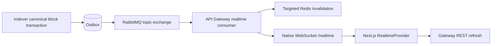

# Phase 10: Advanced Blockchain Explorer

Phase 10 smart contract detection/verification, background transaction tracing, internal call көрінісі, backend-aware search және RabbitMQ → Gateway → native WebSocket live Explorer қосады. Phase 7 auth, Phase 8 portfolio intelligence және Phase 9 dark responsive frontend сақталады. TypeScript strict, NodeNext/ESM `.js` imports, Drizzle және custom Ethereum RPC client қолданылады.

## 1. Service ownership және smart contract detection

Gateway `identity_db`, Indexer `explorer_db`, Portfolio Service `portfolio_db` иесі болып қалады. Gateway Explorer деректерін тек internal HTTP арқылы алады; browser тек Gateway public API мен `/realtime` endpoint-іне қосылады.

`receipt.contractAddress` contract creation-ды анықтап, address registry-ді `isContract=true` етеді. Registry-дегі contract екені белгілі address үшін қайта `eth_getCode` жіберілмейді. Қалған discovered address-терге canonical block transaction ішінде detection intent жазылады; RPC тек бөлек enrichment dispatcher арқылы орындалады. `eth_getCode` нақты last-seen block tag-пен сұралады; `0x` — code жоқ, `0x00` сияқты all-zero bytecode да contract code болып саналады. Successful check registry-де сақталады; failed check ең көбі үш рет және бір минут cooldown арқылы қайталанады.

## 2. Etherscan verification flow

`EtherscanClient` [Etherscan V2 getsourcecode](https://docs.etherscan.io/api-reference/endpoint/getsourcecode) форматын қолданады: `chainid`, `module=contract`, `action=getsourcecode`, `address` және ENV-дегі `apikey`. Chain ID indexed Ethereum chain-мен сәйкес болуы керек. API key кодқа, browser bundle-ге немесе public жауапқа шығарылмайды.

Provider response тексеріліп, source мәтіні және JSON ABI сақталады. Multi-file Standard JSON source өзгертілмей сақталады; код орындалмайды. Бос source немесе provider-дің «not verified» нәтижесі — қалыпты `unverified`. Key орнатылмаған немесе provider chain/method unsupported болса — `unsupported`. Бұл external lookup пен сақталған local result-ты оқу flow-ы; local Solidity compiler арқылы source submission/recompilation бұл фазада жасалмайды.

## 3. Verification jobs және cooldown

Canonical block commit ішінде `contract_verifications` intent жасалады. Dispatcher оны `verify-contract` BullMQ job-ына аударады; indexing loop Etherscan request-ін күтпейді. Worker concurrency — біреу. Claim attempts және discovered block hash бойынша guarded update арқылы орындалады, сондықтан duplicate delivery не ескі branch job жаңа canonical result-ты ауыстырмайды.

Job ID `verify-<address>-<blockHash немесе legacy>-<attempt>` форматын қолданады. [BullMQ custom ID ішінде colon қолдануға болмайды](https://docs.bullmq.io/guide/jobs/job-ids), сондықтан мысалдағы `verify-contract:<address>` орнына hyphen separator бар. Unverified/failed contract әдепкіде бір тәуліктен кейін қайта қаралады; ең көбі үш logical lookup. HTTP retries жеке bounded policy арқылы орындалады.

## 4. `contract_verifications` және verification states

Existing кестеде contract name, compiler, optimization/runs, source, ABI, constructor arguments, verification source және verified timestamp сақталады. Minimal additive fields: `status`, discovered block/hash, last check, next attempt, attempts және sanitized error code. `verified_at` nullable болды, сондықтан pending/unverified үшін жалған verified timestamp берілмейді.

Allowed states: `verified`, `unverified`, `pending`, `unsupported`, `failed`. Public `verified=true` тек `status=verified`, non-empty source және array ABI болғанда беріледі. Legacy inconsistent source/ABI verified row UI-де verified ретінде көрсетілмейді. Unknown address немесе indexed EOA үшін contract endpoint — `404`; invalid address — `400`.

## 5. Transaction tracing flow

Block commit `transaction_trace_requests` ішіне durable intent жазады. Әдепкіде contract creation және known contract-ке interaction ғана таңдалады. Dispatcher `trace-transaction` job-ын береді; Ethereum execution trace block ingestion-нан бөлек worker арқылы алынады. Trace read endpoint indexed eligible transaction үшін intent-ті idempotent түрде сұрата алады.

Transaction trace request нақты transaction hash, block number және block hash-ты сақтайды. Provider response кейін қайта canonical transaction тексеріледі. Guarded transactional replacement trace rows пен request status-ты бірге commit етеді; reorg branch нәтижесі жаңа canonical branch-ке жазылмайды.

## 6. `debug_traceTransaction` және provider capability

Existing `EthereumRpcClient.traceTransaction` қолданылады, `ethers`/`viem` енгізілмейді. Worker `debug_traceTransaction(hash, { tracer: "callTracer", timeout: "...s" })` жібереді. [Geth callTracer](https://geth.ethereum.org/docs/developers/evm-tracing/built-in-tracers) execution call tree береді; opcode trace arbitrary fallback ретінде ойдан call tree-ге айналдырылмайды.

Trace RPC үшін бөлек client, timeout, low concurrency және rate limit бар. Provider debug API/callTracer-ді қолдамаса request `unsupported` болады; process ішінде capability flag келесі jobs-тың pointless RPC retries-ын тоқтатады. Restart кезінде provider capability қайта байқала алады. Core block indexing, Explorer REST және portfolio flow жалғасады.

## 7. Call tree normalization және `traceAddress`

Untrusted nested payload iterative stack арқылы pre-order flatten жасалады. Convention: `root`, `0`, `0.0`, `0.1`, `1`, `1.0`; root depth — нөл, `0.1` depth — екі. Address, hex bytes және quantities тексеріледі; value/gas/gasUsed decimal strings болып сақталады. Limit: 10 000 call, depth 32 және bounded path/input/output/error length. Malformed не шамадан тыс үлкен tree controlled failure болады.

Existing `transaction_traces` unique transaction-hash/trace-address constraint сақталады. Database sort numeric path segments бойынша жасалады: `2` segment `10`-нан бұрын тұрады.

## 8. Internal calls және Ethereum semantics

Supported provider types: `CALL`, `CALLCODE`, `DELEGATECALL`, `STATICCALL`, `CREATE`, `CREATE2`, `SELFDESTRUCT`. UI `Internal Calls` деп атайды; олар бөлек signed Ethereum transactions деп көрсетілмейді.

`valueBearing=true` тек root емес, positive value бар, failed емес `CALL`/`CREATE`/`CREATE2`/`SELFDESTRUCT` үшін беріледі. Reverted ancestor ішіндегі apparent successful child та transfer ретінде есептелмейді. Delegate/static execution value жаңа ETH transfer деп саналмайды. `internalCalls` — осы semantically filtered trace subset.

## 9. BullMQ tracing және durable request states

Queues бөлек: `<EXPLORER_JOBS_QUEUE_PREFIX>-verification` және `...-traces`. Trace job ID `trace-<transactionHash>-<blockHash>` — бір canonical transaction үшін stable. Queue/Worker/Job messaging package-тің бір BullMQ **5.81.5** type system-ін қолданады; unsafe casts не `any` workaround қосылмайды.

Trace states: `not_requested`, `queued`, `processing`, `completed`, `unsupported`, `failed`. Әдепкі worker concurrency біреу; retry саны үш және exponential backoff. PostgreSQL intent Redis unavailable кезінде жоғалмайды; dispatcher қайта enqueue жасай алады. Graceful shutdown dispatcher-ді тоқтатады, in-flight provider requests-ті abort етеді, workers пен queues-ті жабады.

## 10. Real-time architecture



Existing versioned Rabbit events өзгермейді. Browser-safe `RealtimeExplorerEvent` union `{ id, type, occurredAt, payload }` береді: `block.indexed`, `token.transfer.indexed`, `chain.reorganized`. Internal version/producer және arbitrary payload fields allowlist mapper арқылы алынып тасталады. Жеке user alerts осы public stream-ге қосылмайды.

## 11. RabbitMQ → Gateway → WebSocket

Native Nest [WsAdapter](https://docs.nestjs.com/websockets/adapter), `@nestjs/websockets`, `@nestjs/platform-ws` және direct `ws` dependency қолданылады. Socket.IO қосылмайды. HTTP server мен `/realtime` бір Gateway port-та жұмыс істейді.

Әр Gateway instance өз UUID suffix-і бар exclusive, non-durable, auto-delete queue алады. Бұл барлық replicas-қа fanout береді; shared consumer queue арқылы load-balancing жасалмайды. Live queue максимум 10 000 message, TTL бес минут, incoming broker event максимум 16 KiB. Malformed events retry loop жасамай reject болады. Replay IDs memory-де ең көбі 2 000 және бес минут сақталады. Missing live data REST refresh арқылы қалпына келеді; indexer outbox durability сақталады.

## 12. Frontend realtime reconnect және security

Бір root `RealtimeProvider` native browser WebSocket-ті басқарады. Connection states: `connecting`, `live`, `reconnecting`, `offline`, `unconfigured`. Client generation guard ескі socket callback-тарын қабылдамайды; bounded duplicate cache, 15-second handshake deadline, capped exponential backoff/jitter және browser online/offline handling бар. Unmount timers/socket-ті жабады. Reconnect кейін relevant resources REST арқылы қайта оқылады; polling fallback сақталады.

Gateway browser Origin-ді exact `WEB_ORIGIN` бойынша тексереді. Origin-less CLI/native clients тек public events алады. Maximum configured clients — 500; бір remote IP үшін максимум 20. Heartbeat ping/pong — 30 секунд; slow client buffered data 256 KiB-тан асса disconnect. Client frames максимум 1 KiB; unsupported inbound messages бес message/10 seconds шегінен асса close `1008`. Private channels, JWT/userId subscription және incoming client commands жоқ.

## 13. Cache invalidation және reorg

`block.indexed` stats/network-status және blocks first-page limit variants-ті invalidate етеді. Token transfer тиісті token және from/to address resources-ті invalidate етеді. Reorg барлық `explorer:` namespace-ті invalidate етеді, соның ішінде old block/hash/tx details.

Messaging Redis helper namespaced `SCAN COUNT 100` + `UNLINK` batches қолданады; production hot path-та `KEYS` жоқ. Cache operations 750 ms deadline-мен fail open болады. Generation guard in-flight factory-дің invalidation-нан кейін old result-ты қайта cache-ке жазуына жол бермейді. Redis outage кезінде missed invalidation белгіленеді; recovery ping stale namespace-ті тазаламай cache read-ті қайта қоспайды.

UI reorg notice береді және relevant resources reload жасайды. Older blocks pagination жаңа block event келгенде автоматты ауыстырылмайды; `New blocks available` link latest page-ке explicit navigation береді. Address/token resources тек қатысы бар transfer мен reorg events бойынша жаңарады.

## 14. Backend-aware search және block hash

`GET /search?q=` indexed data бойынша resolution орындайды. Digits canonical block number-ге; 64 hex таңбалы hash алдымен transaction-ға, кейін block hash-қа; Ethereum address алдымен indexed token, кейін contract, кейін ordinary address-ке resolve болады. Unknown indexed resource — `404`, malformed/out-of-range query — `400`. Search өздігінен arbitrary RPC discovery жасамайды.

Response `{ type, value, destination }` тек белгілі public route-тарға бағыттайды. Gateway/browser decoders external/open redirect destination-ді қабылдамайды. Existing `/blocks/:number` route сақталады; hash үшін additive `/blocks/hash/:hash`. Browser `/search` backend result-тың destination-ын қолданады, regex-only guess-ке сүйенбейді.

## 15. Network status

Indexer background service chain ID-ді тексеріп, DB indexed height пен RPC latest height snapshot-ын жаңартады. Public request әр жолы RPC шақырмайды; Gateway қысқа TTL cache пайдаланады. Response fields: `chainId`, `networkName`, `rpcLatestBlock`, `indexedBlock`, `lag`, `status`, `updatedAt`.

Lag `BigInt` subtraction арқылы decimal string болады. Unknown/mismatched немесе RPC head indexed height-тен артта болса — `null`; жалған zero көрсетілмейді. Allowed status: `starting`, `syncing`, `synced`, `degraded`, `stopped`. INDEXER_ENABLED=false кезінде background observation қолжетімді болса height snapshot сақталып, status `stopped` болады. Frontend header/live indicator network name, indexed height және lag көрсетеді.

## 16. ENV және іске қосу

`.env.example` public defaults береді; нақты API keys жергілікті `.env` ішінде ғана. Phase 10 settings:

```dotenv
ETHERSCAN_BASE_URL=https://api.etherscan.io/v2/api
ETHERSCAN_API_KEY=
ETHERSCAN_CHAIN_ID=11155111
ETHERSCAN_TIMEOUT_MS=10000
ETHERSCAN_MAX_RETRIES=4
ETHERSCAN_REQUESTS_PER_SECOND=2
CONTRACT_VERIFICATION_ENABLED=true
CONTRACT_VERIFICATION_COOLDOWN_MS=86400000
CONTRACT_VERIFICATION_MAX_LOOKUPS=3
EXPLORER_ENRICHMENT_ENABLED=true
EXPLORER_JOBS_QUEUE_PREFIX=explorer
TRACE_ENABLED=true
TRACE_ONLY_CONTRACT_INTERACTIONS=true
TRACE_WORKER_CONCURRENCY=1
TRACE_MAX_RETRIES=3
TRACE_TIMEOUT_MS=15000
NETWORK_STATUS_INTERVAL_MS=15000
NETWORK_STATUS_TIMEOUT_MS=2500
REALTIME_ENABLED=true
REALTIME_EVENTS_QUEUE=explorer.realtime
REALTIME_MAX_CLIENTS=500
NEXT_PUBLIC_WS_URL=ws://localhost:3000/realtime
```

`ETHERSCAN_CHAIN_ID` және `ETHEREUM_CHAIN_ID` сәйкес болуы керек. Frontend `NEXT_PUBLIC_API_URL` Gateway URL болады; HTTPS deployment үшін public WS URL `wss://` қолданады. Next public ENV production build кезінде bundle-ге бекітіледі; backend keys/URLs public ENV-ге енгізілмейді.

## 17. Endpoint-тер және frontend UI

| Gateway public endpoint | Indexer internal endpoint | Міндеті |
| --- | --- | --- |
| `GET /contract/:address` | `/internal/explorer/contracts/:address` | Indexed contract және stored verification |
| `GET /tx/:hash/traces` | `/internal/explorer/transactions/:hash/traces` | Trace status, call tree, internal calls |
| `GET /blocks/hash/:hash` | `/internal/explorer/blocks/hash/:hash` | Canonical indexed block hash lookup |
| `GET /search?q=` | `/internal/explorer/search?q=` | Indexed route resolution |
| `GET /network/status` | `/internal/explorer/network/status` | Background network snapshot |
| `WS /realtime` | RabbitMQ consumer | Public stable live events |

Internal HTTP token guard сақталады. Gateway new responses runtime decode жасап, тек public fields қайтарады; raw upstream SQL/URL/credentials/errors шықпайды және redirects қабылданбайды.

`/contract/[address]` overview, verification badge, compiler/optimization, seen blocks және Transactions/Token Transfers/Contract/ABI tabs береді. Source/ABI text React арқылы escaped түрде scrollable code panel-де көрсетіледі; copy және collapsible ABI бар. Transaction page Overview/Token Transfers/Logs/Internal Calls tabs, exact method selector және honest `Unknown method` label береді. Arbitrary ABI method decoding енгізілмейді. Trace UI flattened rows қолданады: ең көбі 5 000 row, visual indent максимум 12; қалған сан көрсетіледі. Existing dark design және responsive/mobile overflow сақталады.

## 18. Негізгі файлдар және migration

Indexer `src/modules/advanced/`: configuration, provider limiter/client, contract detection, durable repository/service, BullMQ dispatcher/workers және call-trace normalizer. Indexer Explorer search/network files public BFF-ке internal HTTP data береді. Gateway `modules/realtime/` public event mapping, deduplication, broker lifecycle және native gateway-ді басқарады; `advanced-explorer.decoder.ts` boundary validation береді. Shared advanced HTTP/realtime DTO-лары `packages/contracts` root және browser exports-ында бар.

Frontend `lib/api/advanced-explorer.*`, `lib/realtime/`, `providers/realtime-provider.tsx`, Explorer contract/trace components және live status/resource-event helpers жаңа functionality-ді жүзеге асырады. Verification production code-ке test endpoint қоспайды; built BlockProcessor test child process IPC арқылы ғана шақырылады.

Drizzle migration `apps/indexer-service/src/database/migrations/0002_hard_luckman.sql` generate/inspect жасалып, нақты Indexer database-іне **сәтті қолданылды (exit 0)**. Жаңа `transaction_trace_requests` state table, transaction/block foreign keys cascade және dispatcher index қосылды; `addresses` detection check fields, `contract_verifications` lookup state/cooldown fields және nullable verified timestamp енгізілді. Existing verification/trace tables және деректер сақталады. Trace requests reorg block deletion-ымен cascade болады; verification/detection metadata canonical branch бойынша repair жасалады. Database volumes өшірілмейді.

Direct dependencies: `@nestjs/websockets@12.1.2`, `@nestjs/platform-ws@12.1.2`, `ws@8.22.0`; dev dependency `@types/ws@8.18.2`. Nest packages existing installed Nest 12.1.2-мен сәйкес. Frontend UI/chart/socket library және new ORM енгізілмеді; workspace BullMQ бұрынғы бір **5.81.5** нұсқасында.

## 19. Test және verification

Gateway build, strict typecheck, **94 unit tests** және existing health **1 e2e test** өтті. Unit coverage realtime allowlist/malformed payloads, deduplication, origin, actual loopback WS broadcast/shutdown/abuse handling, broker outage/reconnect, replica queue fanout, cache invalidation/race/recovery және advanced HTTP response validation/size limit-ті қамтиды.

`pnpm verify:phase10` нақты isolated PostgreSQL, Redis, RabbitMQ, BullMQ, native WebSocket және built services қолданады. Etherscan/RPC/CoinGecko responses deterministic local fixture server-ден келеді. Script actual BlockProcessor-ді IPC арқылы шақырып, canonical block/outbox/enrichment intents, actual verify/trace jobs, stored rows, unsupported bounded behavior, search, Origin handshake, broadcasts, delivery replay және targeted cache invalidation тексереді. Production web бөлек `.next-phase10` distDir ішінде build жасалып, route HTML/browser bundle тексеріледі; бұл browser interaction/hydration validation деп есептелмейді.

Temporary databases кездейсоқ run ID және ownership comment арқылы дәлелденеді. Redis/cache/Bull queues және Rabbit topology бөлек namespaced. Cleanup өз child processes/socket-ті graceful жабады, marker-proven databases және осы run-ның keys/queues/exchanges ғана алынады; Next generated config previous content-і сырттан өзгермегені тексеріліп қалпына келеді.

Required commands:

```powershell
pnpm install
pnpm build:packages
pnpm --dir apps/api-gateway build
pnpm --dir apps/indexer-service build
pnpm --dir apps/portfolio-service build
pnpm --dir apps/web build
pnpm --dir apps/web lint
pnpm --dir apps/api-gateway test
pnpm --dir apps/indexer-service test
pnpm --dir apps/portfolio-service test
pnpm --dir apps/web test
pnpm verify:phase7
pnpm verify:phase8
pnpm verify:phase9
pnpm verify:phase10
```

Соңғы орындалған тексерулер:

| Тексеру | Нәтиже |
| --- | --- |
| `pnpm install` | Exit 0 |
| `pnpm build:packages` | Exit 0 |
| Gateway, Indexer, Portfolio builds | Үшеуі де exit 0; TypeScript қатесі жоқ |
| Web production build | Exit 0; TypeScript қатесі жоқ |
| Frontend lint | Exit 0 |
| Full unit suites | **442/442**: Gateway 94, Indexer 91, Portfolio 106, Web 151; 50 test files |
| New Phase 10 unit coverage | **186 жаңа тексеріс**, 256 previous baseline tests сақталды |
| Existing health e2e | **3/3**: Gateway, Indexer, Portfolio |
| `verify:phase7` | **11 passed**, exit 0, own-resource cleanup өтті |
| `verify:phase8` | **24 passed**, exit 0, own-resource cleanup өтті |
| `verify:phase9` | **17/17 passed**, exit 0; бес shutdown/cleanup group өтті |
| `verify:phase10` | **17 passed**, exit 0; бес shutdown/cleanup group өтті |
| Script syntax және whitespace | `node --check`, `git diff --check` өтті |

Phase 9/10 verification production web build, HTTP routes/HTML, configured browser JavaScript және native WebSocket integration-ды тексерді. Live external Etherscan/RPC lookup deterministic Phase 10 run ішінде тексерілген жоқ. Browser surface қолжетімсіз болғандықтан interactive visual/hydration және click interaction тексеруі орындалмады; HTTP/build smoke coverage browser interaction ретінде көрсетілмейді.

Remaining build/test/integration errors жоқ. Бұрыннан бар dependency deprecation, nested workspace және Vite tsconfig-paths notice сақталды. `pnpm peers check` **exit 1**: existing `tsconfck@3.1.6` TypeScript `^5` сұрайды, ал installed TypeScript — `6.0.3`; бұл peer warning барлық build/test pass нәтижесін өзгертпейді. Local Etherscan key бос болғанда verification `unsupported` — қалыпты configuration state.

## 20. Failure handling және Phase 11 foundation

Etherscan timeout/429/Retry-After server errors rate limiter, bounded retries және cooldown-мен өңделеді. Typed error log/body API key немесе raw response шығармайды. Unverified valid state болып қалады. Trace unsupported не failed болса controlled status API-ге беріледі; indexing loop тоқтамайды. Redis cache fails open, PostgreSQL enrichment intent durable қалады. Rabbit bridge startup-ты блоктамайды, exponential reconnect жасайды; WebSocket client failure басқа clients пен REST application-ды тоқтатпайды.

Phase 11 үшін canonical durable enrichment jobs, typed stored verification/trace APIs, browser-safe live DTOs, public channel security boundary, cache invalidation hooks, provider capability handling және reusable contract/trace/live UI дайын. Private realtime alerts қосылса JWT/user-scoped subscription мен ownership осы public stream-нен бөлек енгізілуі керек.


## Created files

**58 жаңа файл.**

| Файл | Өзгеріс |
| --- | --- |
| `apps/api-gateway/src/modules/cache/cache.service.spec.ts` | Module validation, state mapping, precision, lifecycle немесе failure behavior meaningful unit tests арқылы тексеріледі. |
| `apps/api-gateway/src/modules/explorer/advanced-explorer.decoder.spec.ts` | Module validation, state mapping, precision, lifecycle немесе failure behavior meaningful unit tests арқылы тексеріледі. |
| `apps/api-gateway/src/modules/explorer/advanced-explorer.decoder.ts` | Advanced HTTP DTO runtime validation және safe public response selection. |
| `apps/api-gateway/src/modules/explorer/indexer-explorer.client.spec.ts` | Module validation, state mapping, precision, lifecycle немесе failure behavior meaningful unit tests арқылы тексеріледі. |
| `apps/api-gateway/src/modules/realtime/realtime-event.mapper.spec.ts` | Module validation, state mapping, precision, lifecycle немесе failure behavior meaningful unit tests арқылы тексеріледі. |
| `apps/api-gateway/src/modules/realtime/realtime-event.mapper.ts` | Internal events-тің public allowlist mapping және bounded replay suppression. |
| `apps/api-gateway/src/modules/realtime/realtime-events.consumer.spec.ts` | Module validation, state mapping, precision, lifecycle немесе failure behavior meaningful unit tests арқылы тексеріледі. |
| `apps/api-gateway/src/modules/realtime/realtime-events.consumer.ts` | Per-instance ephemeral Rabbit fanout, reconnect, cache invalidation және mapped broadcasts. |
| `apps/api-gateway/src/modules/realtime/realtime.gateway.spec.ts` | Module validation, state mapping, precision, lifecycle немесе failure behavior meaningful unit tests арқылы тексеріледі. |
| `apps/api-gateway/src/modules/realtime/realtime.gateway.ts` | Public native WS broadcast, Origin/abuse limits, heartbeat және shutdown. |
| `apps/api-gateway/src/modules/realtime/realtime.module.ts` | Gateway socket және Rabbit consumer providers тіркеледі. |
| `apps/indexer-service/src/database/migrations/0002_hard_luckman.sql` | Existing data-ны сақтайтын additive Phase 10 migration. |
| `apps/indexer-service/src/database/migrations/meta/0002_snapshot.json` | Drizzle жаңа schema snapshot-ын сақтайды. |
| `apps/indexer-service/src/database/schema/transaction-trace-requests.schema.ts` | Durable trace request status, canonical hash және retry dispatch schema. |
| `apps/indexer-service/src/modules/advanced/advanced-explorer.module.ts` | Detection, provider, repository және jobs services Nest module-де бірігеді. |
| `apps/indexer-service/src/modules/advanced/advanced-explorer.repository.ts` | Drizzle durable intents, guarded claims және verification/trace atomic commits. |
| `apps/indexer-service/src/modules/advanced/advanced-explorer.service.spec.ts` | Module validation, state mapping, precision, lifecycle немесе failure behavior meaningful unit tests арқылы тексеріледі. |
| `apps/indexer-service/src/modules/advanced/advanced-explorer.service.ts` | Stored contract detail және trace availability/internal-call DTO mapping. |
| `apps/indexer-service/src/modules/advanced/advanced-jobs.service.spec.ts` | Module validation, state mapping, precision, lifecycle немесе failure behavior meaningful unit tests арқылы тексеріледі. |
| `apps/indexer-service/src/modules/advanced/advanced-jobs.service.ts` | Separate BullMQ verify-contract/trace-transaction dispatcher және workers. |
| `apps/indexer-service/src/modules/advanced/advanced.config.ts` | Provider/job flags, timeout/count/chain/rate configuration validation. |
| `apps/indexer-service/src/modules/advanced/advanced.fixtures.ts` | Unit tests үшін deterministic typed in-memory fixtures. |
| `apps/indexer-service/src/modules/advanced/contract-detection.service.ts` | Bounded background eth_getCode lookup және checked registry caching. |
| `apps/indexer-service/src/modules/advanced/contract-detection.spec.ts` | Module validation, state mapping, precision, lifecycle немесе failure behavior meaningful unit tests арқылы тексеріледі. |
| `apps/indexer-service/src/modules/advanced/etherscan.client.spec.ts` | Module validation, state mapping, precision, lifecycle немесе failure behavior meaningful unit tests арқылы тексеріледі. |
| `apps/indexer-service/src/modules/advanced/etherscan.client.ts` | Etherscan V2 lookup, validated source/ABI, timeout/retry/cooldown және safe typed errors. |
| `apps/indexer-service/src/modules/advanced/request-limiter.ts` | Provider rate/cooldown және shutdown-aware pending work scheduling. |
| `apps/indexer-service/src/modules/advanced/trace-normalizer.spec.ts` | Module validation, state mapping, precision, lifecycle немесе failure behavior meaningful unit tests арқылы тексеріледі. |
| `apps/indexer-service/src/modules/advanced/trace-normalizer.ts` | Iterative call-tree flattening, canonical trace paths және value semantics. |
| `apps/indexer-service/src/modules/explorer/network-status.service.ts` | Background chain/head/DB observation және cached typed snapshot. |
| `apps/indexer-service/src/modules/explorer/network-status.spec.ts` | Module validation, state mapping, precision, lifecycle немесе failure behavior meaningful unit tests арқылы тексеріледі. |
| `apps/indexer-service/src/modules/explorer/network-status.ts` | Precision-safe nullable BigInt lag calculation. |
| `apps/indexer-service/src/modules/explorer/search-resolution.spec.ts` | Module validation, state mapping, precision, lifecycle немесе failure behavior meaningful unit tests арқылы тексеріледі. |
| `apps/indexer-service/src/modules/explorer/search-resolution.ts` | Indexed block/hash/transaction/token/contract/address routing resolution. |
| `apps/web/src/app/(explorer)/contract/[address]/page.tsx` | Validated contract detail Next.js route және metadata. |
| `apps/web/src/features/explorer/advanced.module.css` | Dark responsive contract/trace/code panel styling және bounded overflow. |
| `apps/web/src/features/explorer/code-panel.tsx` | Escaped text, exact copy және accessible scrollable source/ABI/input panel. |
| `apps/web/src/features/explorer/contract-page.tsx` | Verification overview, source/ABI tabs және indexed activity view. |
| `apps/web/src/features/explorer/search-page.tsx` | Backend resolution, loading/error/404 және safe navigation. |
| `apps/web/src/features/explorer/trace-tree.spec.ts` | Module validation, state mapping, precision, lifecycle немесе failure behavior meaningful unit tests арқылы тексеріледі. |
| `apps/web/src/features/explorer/trace-tree.ts` | Bounded visual trace rows, numeric path sort және exact selector extraction. |
| `apps/web/src/features/explorer/trace-view.tsx` | Internal call tree/status UI және accessible detailed rows. |
| `apps/web/src/features/realtime/live-status.tsx` | Network, lag және semantic socket connection indicator. |
| `apps/web/src/features/realtime/realtime.module.css` | Responsive network/live status styles. |
| `apps/web/src/features/realtime/resource-events.ts` | Address/token/block relevance және targeted refresh predicates. |
| `apps/web/src/features/realtime/status-display.spec.ts` | Module validation, state mapping, precision, lifecycle немесе failure behavior meaningful unit tests арқылы тексеріледі. |
| `apps/web/src/features/realtime/status-display.ts` | Verification/trace/network/socket states honest labels/tones-ға map жасалады. |
| `apps/web/src/lib/api/advanced-explorer.api.ts` | Browser typed Gateway contract/traces/search/network API methods. |
| `apps/web/src/lib/api/advanced-explorer.decoder.spec.ts` | Module validation, state mapping, precision, lifecycle немесе failure behavior meaningful unit tests арқылы тексеріледі. |
| `apps/web/src/lib/api/advanced-explorer.decoder.ts` | Advanced HTTP DTO runtime validation және safe public response selection. |
| `apps/web/src/lib/realtime/realtime-client.spec.ts` | Module validation, state mapping, precision, lifecycle немесе failure behavior meaningful unit tests арқылы тексеріледі. |
| `apps/web/src/lib/realtime/realtime-client.ts` | Native browser socket lifecycle, reconnect jitter, generation guards және dedup. |
| `apps/web/src/lib/realtime/realtime.decoder.ts` | Untrusted public WebSocket JSON runtime validation. |
| `apps/web/src/providers/realtime-provider.tsx` | One shared connection, subscriptions, network polling және reorg notice lifecycle. |
| `docs/phase-10-advanced-explorer.md` | Қазақша architecture, ENV, endpoints, tests және complete file inventory. |
| `packages/contracts/src/http/advanced-explorer.contracts.ts` | Browser-safe advanced HTTP contracts және explicit state unions. |
| `packages/contracts/src/realtime/realtime.contracts.ts` | Browser-safe public stable Explorer event union. |
| `scripts/verify-phase-10.mjs` | Isolated real storage/broker/jobs/WS integration және deterministic provider verification. |

## Modified files

**47 tracked файл өзгерді.** Generated buildinfo artifacts санға кірмейді және source changes ретінде қалдырылмайды.

| Файл | Өзгеріс |
| --- | --- |
| `.env.example` | Phase 10 provider, workers, network/realtime және public WS defaults қосылды; secrets бос. |
| `.gitignore` | Isolated Phase 10 Next output және temporary tsconfig ignored болады. |
| `apps/api-gateway/package.json` | Nest 12.1.2 WebSocket packages, ws және ws type dependency қосылды. |
| `apps/api-gateway/src/app.module.ts` | Realtime module existing REST modules-мен бірге тіркелді. |
| `apps/api-gateway/src/main.ts` | Native WsAdapter existing HTTP server-ге орнатылды. |
| `apps/api-gateway/src/modules/cache/cache.service.ts` | Deadline, targeted/reorg invalidation, generation guard және missed-invalidation recovery қосылды. |
| `apps/api-gateway/src/modules/explorer/explorer.controller.ts` | Contract, traces, block hash, search және network status public routes қосылды. |
| `apps/api-gateway/src/modules/explorer/explorer.service.ts` | Advanced HTTP responses үшін typed cache және BFF methods қосылды. |
| `apps/api-gateway/src/modules/explorer/indexer-explorer.client.ts` | Advanced internal HTTP, runtime decoding, sanitized errors, redirect prohibition және bounded stream reader қосылды. |
| `apps/api-gateway/test/app.e2e-spec.ts` | Existing health e2e Phase 10 background jobs-ты өшіріп test isolation сақтайды. |
| `apps/indexer-service/src/database/migrations/meta/_journal.json` | Drizzle Phase 10 migration journal entry қосылды. |
| `apps/indexer-service/src/database/schema/addresses.schema.ts` | Code detection check height, cooldown және attempts fields қосылды. |
| `apps/indexer-service/src/database/schema/contract-verifications.schema.ts` | Verification status/attempt/cooldown және canonical discovery metadata қосылды. |
| `apps/indexer-service/src/database/schema/index.ts` | Trace request schema export қосылды. |
| `apps/indexer-service/src/modules/chain-sync/block-processor.service.ts` | Canonical block transaction durable detection/verification/trace intents жазады. |
| `apps/indexer-service/src/modules/chain-sync/chain-sync.module.ts` | Existing ingestion enrichment module-ді reuse етеді. |
| `apps/indexer-service/src/modules/chain-sync/reorg.service.ts` | Orphan verification және detection metadata canonical ancestor-ға сәйкес reset жасалады. |
| `apps/indexer-service/src/modules/explorer/explorer-query.service.ts` | Indexed block hash және address/token/contract lookup methods қосылды. |
| `apps/indexer-service/src/modules/explorer/explorer.controller.ts` | Token-guarded advanced internal Explorer endpoints қосылды. |
| `apps/indexer-service/src/modules/explorer/explorer.module.ts` | Advanced service және background network status providers тіркелді. |
| `apps/indexer-service/test/app.e2e-spec.ts` | Existing health e2e Phase 10 background jobs-ты өшіріп test isolation сақтайды. |
| `apps/web/.env.example` | Public native WebSocket URL қосылды. |
| `apps/web/eslint.config.mjs` | Generated isolated Phase 10 Next output lint-тен шығарылды. |
| `apps/web/src/app/(explorer)/search/page.tsx` | Backend-aware search feature route-қа қосылды. |
| `apps/web/src/app/layout.tsx` | Shared realtime provider root browser lifecycle-ге қосылды. |
| `apps/web/src/components/layout/navigation.tsx` | Network/live status existing navigation-да көрсетіледі. |
| `apps/web/src/components/ui-controls.tsx` | Tabs keyboard navigation және ARIA accessibility кеңейді. |
| `apps/web/src/features/explorer/address-page.tsx` | Contract distinction/link және relevant transfer/reorg reload қосылды. |
| `apps/web/src/features/explorer/block-page.tsx` | Reorg кезінде detail resource жаңарады. |
| `apps/web/src/features/explorer/blocks-page.tsx` | Latest-page live refresh және older-page new-block notice pagination-ды сақтайды. |
| `apps/web/src/features/explorer/overview.tsx` | Block/reorg events stats және latest list refresh жасайды. |
| `apps/web/src/features/explorer/search-form.tsx` | Backend-aware search navigation және input/error states қосылды. |
| `apps/web/src/features/explorer/token-page.tsx` | Token-ға қатысты transfer/reorg events reload жасайды. |
| `apps/web/src/features/explorer/transaction-page.tsx` | Logs/Internal Calls tabs, exact selector және contract link қосылды. |
| `apps/web/src/lib/utils/search.ts` | Public search destination validation және backend route support қосылды. |
| `apps/web/tsconfig.json` | Generated isolated Phase 10 output normal typecheck-тен шығарылды. |
| `package.json` | verify:phase10 command қосылды. |
| `packages/blockchain-client/src/ethereum-rpc.client.ts` | Client close lifecycle in-flight requests пен pending rate-limit work-ті тоқтатады. |
| `packages/blockchain-client/src/rpc-rate-limiter.ts` | Shutdown pending limiter work-ті reject/cleanup жасайды. |
| `packages/contracts/src/browser.ts` | Advanced Explorer және public realtime type exports қосылды. |
| `packages/contracts/src/index.ts` | Advanced Explorer және public realtime DTO exports қосылды. |
| `packages/messaging/src/rabbitmq/rabbitmq.client.ts` | Default durable consumer сақталып, ephemeral fanout/limits және closed-channel failure isolation қосылды. |
| `packages/messaging/src/redis/redis-cache.client.ts` | Literal namespaced SCAN/UNLINK prefix invalidation helper қосылды. |
| `pnpm-lock.yaml` | New WebSocket direct dependencies exact resolution-мен lock жасалды. |
| `scripts/verify-phase-7.mjs` | Isolated regression run ішінде new enrichment/realtime фондық жұмысын өшіреді. |
| `scripts/verify-phase-8.mjs` | Isolated regression run ішінде new enrichment/realtime фондық жұмысын өшіреді. |
| `scripts/verify-phase-9.mjs` | Isolated regression feature toggles және public WS URL конфигурациясы қосылды. |

## Removed files және жергілікті конфигурация

Source файлдар жойылмады. Git-ке кірмейтін жергілікті `.env` Phase 10 missing defaults-пен толықтырылды; бар secrets/connection values сақталды. `apps/web/.env.local` public WebSocket URL-мен толықтырылды; backend secrets жазылмады. Үш tracked service buildinfo файлы бастапқы bytes-ке қалпына келді және file counts-қа кірмейді.

