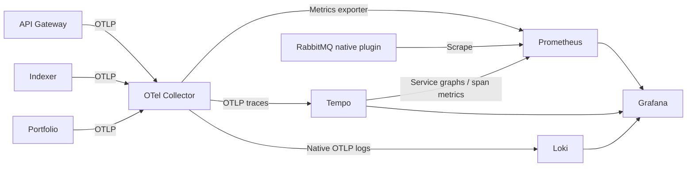

# PHASE 11 — Production Observability

## 1. Observability деген не

Observability — system ішінде не болып жатқанын оның metrics, logs және traces signals-ынан түсіну. PHASE 11 үш backend service-тің HTTP, indexing, provider, database, messaging және worker әрекеттерін нақты runtime-нан өлшейді. Business logic, service ownership және бұрынғы REST/WebSocket behavior сақталған.

## 2. OpenTelemetry деген не

OpenTelemetry — telemetry-ді жинауға, context таратуға және export жасауға арналған vendor-independent API/SDK. `packages/observability` reusable ESM package үш backend пен shared clients үшін бір implementation береді. SDK Nest, HTTP, `pg`, Redis modules load болардан бұрын initializes болады: `main.ts → instrumentation.ts → NodeSDK/ESM hook → dynamic import bootstrap.ts`.

Compatible pinned packages: `@opentelemetry/api@1.9.1`; stable `core/resources/sdk-metrics/sdk-trace-base@2.12.0`; `sdk-node/api-logs/sdk-logs/exporter-*-otlp-proto/instrumentation/instrumentation-http@0.223.0`. Instrumentations: Undici `0.33.0`, PostgreSQL `0.75.0`, Redis/Express `0.71.0`, Nest core `0.69.0`. Бұл API, stable SDK және experimental packages-тің әртүрлі release streams-ы; бір package-тің conflicting implementation-ы емес. Exact dependency graph `pnpm-lock.yaml` ішінде сақталған.

## 3. Metrics, logs және traces айырмасы

| Signal | Беретін жауап | Мысал |
| --- | --- | --- |
| Metrics | Қанша, қаншалықты жиі, қанша уақыт? | Indexer lag, HTTP p95, BullMQ failures |
| Logs | Осы уақытта қандай оқиға болды? | HTTP request completed, safe provider failure |
| Traces | Бір операция қандай services/steps арқылы өтті? | Gateway → Indexer HTTP → outbox → RabbitMQ → worker |

Metrics bounded labels арқылы aggregate болады. Logs structured оқиға мәліметін береді. Traces parent/child spans арқылы операцияның causal байланысын көрсетеді.

## 4. OTel Collector рөлі

Collector OTLP HTTP `4318` және gRPC `4317` қабылдайды. `memory_limiter` 384 MiB limit/96 MiB spike, `batch` 1-second timeout және 1024 max batch size қолданады. Export queues 1024 batch-пен, timeout 5 seconds және retries 60 seconds-пен шектелген.

Metrics Prometheus exporter `8889` endpoint-іне, traces Tempo-ға, logs Loki-дің native OTLP HTTP ingestion path-ына жіберіледі. Collector diagnostics `8888`, health extension `13133` бар. Diagnostics/exporter ports Docker network ішінде ғана.

## 5. Prometheus рөлі

Prometheus әр 15 seconds сайын алты target scrape жасайды: applications, Collector, Prometheus self, RabbitMQ broker, Loki және Tempo. Application `service.name` resource-ы `service_name` label-іне айналады; counters/histograms underscore және стандартты suffix алады. Мысалы `http.server.duration`, unit `s` → `http_server_duration_seconds_bucket`.

Retention — 7 days және 2 GB. Counter/histogram cumulative totals сақталады. `service.instance.id` process-unique UUID болғандықтан parallel replicas және verification instances бір metric series-ке соғылмайды. Collector updated емес points-ты 2 minutes-тен кейін expire етеді.

## 6. Loki рөлі

Loki application structured logs-ты сақтайды. Collector `otlp_http/loki` exporter-і `http://loki:3100/otlp` base path-ына жібереді, exporter `/v1/logs` қосады. Бұл native OTLP ingestion; obsolete Loki exporter немесе Promtail қажет емес. TSDB schema `v13`, structured metadata және 7-day retention орнатылған. [Ресми Loki OTLP ingestion құжаты](https://grafana.com/docs/loki/latest/send-data/otel/).

Index labels тек `service.name`, `service.namespace`, `deployment.environment.name`. Instance UUID, trace ID, span ID және request ID — structured metadata; олар stream cardinality-ін арттырмайды.

## 7. Tempo рөлі

Tempo distributed spans-ты OTLP арқылы қабылдап, local storage/WAL ішінде сақтайды. `-target=all` monolithic mode Kafka талап етпейді. Tempo 3-ке сәйкес `backend_scheduler` және `backend_worker` compaction/retention configuration қолданылады; retention 7 days.

Metrics generator service graphs және span metrics-ті Prometheus remote-write receiver-іне жібереді. Span-name dimension өшірілген, service/kind/status сияқты bounded dimensions сақталған. Tempo health/query HTTP port — `3200`. [Tempo configuration](https://grafana.com/docs/tempo/latest/configuration/).

## 8. Grafana рөлі

Grafana Prometheus metrics, Loki logs және Tempo traces-ке бір UI береді. Үш datasource тұрақты `prometheus`, `loki`, `tempo` UID арқылы автоматты provision болады. Төрт dashboard Blockchain Explorer folder-іне автоматты жүктеледі; manual setup қажет емес.

Datasource correlations: Prometheus exemplars → Tempo (`traceID` — Tempo generator, `trace_id` — compatible OTLP metric producers); Loki `trace_id` derived field → Tempo; Tempo trace → Loki logs және Prometheus metrics; Tempo service map → Prometheus. SDK 2.12 custom HTTP metrics-тен exemplar attachment бермейді; нақты metric-to-trace workflow Tempo-generated span-metric exemplars арқылы дәлелденді.

## 9. Біздің telemetry flow



Service resource names: `blockchain-explorer-api`, `blockchain-explorer-indexer`, `blockchain-explorer-portfolio`. Database ownership өзгермейді: identity_db, explorer_db, portfolio_db. Frontend-ке browser OTel SDK немесе third-party SaaS қосылған жоқ.

## 10. Distributed tracing

HTTP inbound/outbound, Undici/fetch, PostgreSQL, Redis, Express және Nest instrumentations actual runtime modules-ін instrument етеді. HTTP completion middleware request span name-ін parameterized route-пен жаңартады. Custom `withSpan` business result-ты өзгертпей duration, outcome және safe exception status береді.

Indexer spans: `indexer.scan_batch`, `process_block`, `fetch_receipts`, `parse_erc20`, `persist_block`, `reorg`, `verify_contract`, `trace_transaction`. Shared spans: `ethereum.rpc`, `coingecko.request`, `rabbitmq.publish/consume`, `bullmq.enqueue/job`, `redis.cache`. Portfolio spans: valuation, snapshot, price_refresh, alert_evaluation.

## 11. Trace propagation

Gateway internal HTTP clients W3C `traceparent` және validated `x-request-id` жібереді. Request ID тек 1–64 safe ASCII characters қабылдайды; жарамсыз немесе configured secret-пен сәйкес ID орнына UUID жасалады және response header-де қайтарылады. HTTP request spans және custom spans validated ID-ді `request.id` attribute ретінде сақтайды; request ID metric label болмайды.

RabbitMQ producer AMQP headers арқылы context береді; consumer extracted context ішінде CONSUMER span ашады. Outbox durable envelope-ге optional `metadata.traceContext` сақтайды, delayed publisher оны қалпына келтіреді. Existing JSONB payload қолданылады: migration жоқ, old envelope metadata-сыз қабылдана береді, browser mapper internal metadata-ны шығармайды.

BullMQ `job.opts.telemetry.metadata` native field-і context сақтайды; factory queue.add producer span және worker consumer span жасайды. Verification/tracing jobs canonical block outbox metadata-сынан context алады; Portfolio initial-sync JSONB intent-і де context сақтайды. Native HTTP auto propagation мен helpers тек W3C traceparent қолданады; vendor `tracestate` және baggage қабылданбайды/жіберілмейді.

## 12. Custom metrics

HTTP: requests және duration, finite method/route/status labels. Raw URL, transaction hash, address, user ID, email, job ID немесе cache key metric label болмайды.

Indexer: committed blocks/transactions/logs/token transfers, processing duration/errors, valid heights/lag, running state, reorgs, discovered contracts, verification/trace statuses. Network unknown болса gauge point алынып тасталады; stale successful head немесе false zero берілмейді. Collector cache expiry exported old point-ты ең көбі 2 minutes ұстай алады.

RPC/CoinGecko: attempts, durations, errors, RPC retries және rate limits. Portfolio: valuation, price refresh, snapshots, triggered alerts және latest valuation unpriced-asset count. Redis: requests/hits/misses/errors/duration; bounded namespace only. RabbitMQ application counters broker counters-дан бөлек. BullMQ queue counts background-та 15 seconds сайын алынады; scrape Redis-ті query жасамайды. DB pool total/idle/waiting callback connection credentials/SQL шығармайды. Outbox backlog/oldest age metrics 15-second bounded-frequency DB aggregate арқылы жаңарады.

Counters canonical commit немесе actual completion-дан кейін өседі: failed/duplicate snapshot және rolled-back block successful result ретінде есептелмейді. Metrics helper әр label үшін finite vocabulary және gauge registry limit қолданады. BullMQ job label — `job_name`; Prometheus reserved `job` label-імен collision болмауы үшін application job names бөлек сақталады.

## 13. Structured logging

`StructuredLogger` Nest LoggerService-compatible; қосымша logging framework қажет емес. Record fields: timestamp, level, service, sanitized message; contextual traceId, spanId, requestId және optional context.

`LOG_FORMAT=pretty` development stdout үшін, `json` machine parsing үшін. OTLP LogRecord body екі format-та да толық sanitized JSON. Logger active span жоқ кезде де жұмыс істейді. Level threshold `debug/info/warn/error/fatal` қолдайды.

## 14. Trace ID және log correlation

Active span context бар log record автоматты traceId/spanId алады. OTel LogRecord context native Loki `trace_id`/span metadata-ға айналады. Grafana Loki log details ішіндегі View trace link matching Tempo trace-ті ашады. Tempo traces-to-logs link service tag пен trace ID бойынша Loki query жасайды.

Correlation configured болуы мен нақты exported data болуы бөлек тексеріледі: datasource health/provisioning checks configuration-ды, `verify:phase11` real backend request-тің бір trace ID-ін Loki және Tempo-дан тексереді.

## 15. Blockchain Indexer dashboard

`Explorer · Blockchain Indexer` RPC/indexed heights, lag/running state, blocks/transactions/logs/ERC20 throughput, block/RPC latency, RPC errors/rate limits, reorg, contract discovery/verification, traces және outbox age/backlog панельдерін береді. Missing gauge «unknown» ретінде no data болады; fake height енгізілмейді.

Service default variable — `blockchain-explorer-indexer`; query dimensions method/status сияқты known sets-пен шектелген.

## 16. Portfolio dashboard

`Explorer · Portfolio`: valuation rate/latency, price refresh success/unavailable/error, CoinGecko requests/errors/latency, latest unpriced count, created snapshots, triggered alerts және BullMQ jobs.

Alert breakdown finite `alert_type` бойынша: price_above, price_below, wallet_activity, whale. Бұл user немесе wallet level analytics емес, operational aggregate.

## 17. System және Logs/Traces dashboards

`Explorer · System Overview`: service telemetry heartbeat, HTTP rate/errors/latency, active WebSockets, PostgreSQL pool utilization/waiters, cache ratio/duration, RabbitMQ application/broker, BullMQ active/waiting/completed/failed және traced dependencies.

`Explorer · Logs and Traces`: structured logs, operational error logs, custom spans rate/errors/duration, service dependency table және recent TraceQL traces. `service` variable төрт dashboard-та да бар. `service_up` telemetry heartbeat; actual readiness үшін existing `/health` endpoint қолданылады.

## 18. Prometheus alert rules

| Rule | Шарт және күту уақыты |
| --- | --- |
| TelemetryServiceMissing | Үш service heartbeat-інің біреуі absent, 3 minutes |
| IndexerLagHigh | Valid lag > 50 blocks, 5 minutes |
| IndexerStopped | Scanner running = 0, 3 minutes |
| EthereumRpcErrorRateHigh | Error ratio > 20%, кемі 10 attempts/5m, 5 minutes |
| EthereumRpcRateLimited | > 5 rate-limited attempts/5m, 2 minutes |
| ServiceHttp5xxHigh | > 5% server errors, кемі 20 requests/5m, 5 minutes |
| OutboxBacklogHigh | > 1000 pending/processing немесе oldest age > 300s, 5 minutes |
| BullMqJobFailuresHigh | > 5 failed jobs/5m, 2 minutes |
| PortfolioPriceRefreshFailures | ≥ 3 failures/5m, 3 minutes |
| WebSocketDisconnectSpike | > 20 disconnects/5m және new connections-ға ratio > 80%, 2 minutes |
| ObservabilityScrapeFailed | Required monitoring scrape target down, 2 minutes |

Thresholds local development үшін берілген; planned restart socket churn-ға әсер етеді. Rules Prometheus арқылы evaluated болады. Notification receiver/Alertmanager бұл phase-та орнатылмаған, ережелер UI/API арқылы көрінеді.

## 19. Docker observability stack

`compose.observability.yml` жеке `blockchain-explorer-observability` project. Core infrastructure volumes reuse/replacement жасалмайды. Prometheus тек existing external `blockchain-explorer_default` network-ке қосылып `rabbitmq:15692` ішкі endpoint-ін scrape жасайды; алдымен `infra:up` қажет. Observability down external network/core containers-ді жоймайды.

| Image | Explicit pinned version / source |
| --- | --- |
| otel/opentelemetry-collector-contrib | [0.162.0 release](https://github.com/open-telemetry/opentelemetry-collector-releases/releases/tag/v0.162.0) |
| prom/prometheus | [v3.15.0 release](https://github.com/prometheus/prometheus/releases/tag/v3.15.0) |
| grafana/grafana | [13.2.4 release](https://github.com/grafana/grafana/releases/tag/v13.2.4) |
| grafana/loki | [3.7.8 release](https://github.com/grafana/loki/releases/tag/v3.7.8) |
| grafana/tempo | [3.1.0 release](https://github.com/grafana/tempo/releases/tag/v3.1.0) |

Monitoring services memory limit 512 MiB each; Docker logs 10 MiB × 3 files. Grafana automatic plugin preinstall/update өшірілген. Prometheus/Grafana/Tempo native healthchecks бар; minimal Collector/Loki images external readiness endpoints арқылы тексеріледі. Local filesystem storage development үшін, deployed production storage/auth/network policies бөлек operational configuration талап етеді.

## 20. Ports

Барлық monitoring host bindings `127.0.0.1` арқылы:

| Component | Host port | Purpose |
| --- | --- | --- |
| Grafana | 3004 | Read-only dashboard/Explore UI |
| Prometheus | 9090 | Metrics query, targets және alert rules |
| OTel Collector HTTP | 4318 | Backend OTLP HTTP/protobuf |
| OTel Collector gRPC | 4317 | OTLP gRPC receiver |
| Collector health | 13133 | Health extension |
| Loki | 3100 | Log query/readiness |
| Tempo | 3200 | Trace query/readiness |
| RabbitMQ plugin | 15692 | Native broker metrics |

Application ports 3000–3003 өзгермейді. Collector metrics 8888/8889 және Tempo receiver ports тек monitoring Docker network ішінде.

## 21. ENV

```dotenv
OTEL_ENABLED=true
OTEL_EXPORTER_OTLP_ENDPOINT=http://localhost:4318
OTEL_EXPORTER_OTLP_PROTOCOL=http/protobuf
OTEL_SAMPLE_RATIO=1
OTEL_METRIC_EXPORT_INTERVAL_MS=5000
DEPLOYMENT_ENVIRONMENT=development
LOG_FORMAT=pretty
LOG_LEVEL=info
GRAFANA_PORT=3004
PROMETHEUS_PORT=9090
LOKI_PORT=3100
TEMPO_PORT=3200
OTEL_GRPC_PORT=4317
OTEL_HTTP_PORT=4318
OTEL_HEALTH_PORT=13133
RABBITMQ_PROMETHEUS_PORT=15692
```

Default service name әр app instrumentation file-інде берілген. `OTEL_SERVICE_NAME` қажет болса әр process үшін бөлек override; shared root ENV-де бір common service name қою үш service-ті біріктіреді. Sample ratio 0–1, ParentBased sampler incoming sampling decision-ді сақтайды. Backend exporter protocol қазір HTTP/protobuf; invalid endpoint/protocol safe warning-пен telemetry-ді өшіреді.

## 22. Commands

Project root-та:

```powershell
pnpm install
pnpm infra:up
pnpm observability:up
pnpm observability:ps
pnpm build:packages
pnpm dev:api
pnpm dev:indexer
pnpm dev:portfolio
```

Development service commands бөлек terminals-та орындалады. Monitoring-only logs/stop:

```powershell
pnpm observability:logs
pnpm observability:down
```

Verification және regression:

```powershell
pnpm test:observability
pnpm verify:phase11
pnpm verify:phase7
pnpm verify:phase8
pnpm verify:phase9
pnpm verify:phase10
```

`observability:down` volumes-ті жоймайды. Existing `infra:up/down/ps/logs` behavior бұрынғыдай; infra:up тек additive broker metrics plugin/config алады.

## 23. Grafana-ға кіру

[Local Grafana](http://localhost:3004) ашыңыз → Dashboards → Blockchain Explorer. Development stack anonymous Viewer ретінде кіргізеді; hardcoded/default admin password немесе manual datasource creation қажет емес. Provisioned dashboards read-only.

Time range және service variable-ін таңдаңыз. App-тар жұмыс істемесе application panels no data көрсетуі қалыпты; infrastructure targets пен datasource health бәрібір тексеріледі. Explore ішінде Loki/Tempo/Prometheus datasource таңдауға болады.

## 24. Log іздеу

Grafana Explore → Loki:

```logql
{service_name="blockchain-explorer-api"} | json
```

HTTP completion logs:

```logql
{service_name="blockchain-explorer-api"} | json | message="HTTP request completed"
```

Service errors:

```logql
{service_name=~"blockchain-explorer-.+"} | json | level=~"error|fatal"
```

Log details-те trace_id metadata мен TraceID/View trace link бар. Secret/body мәндеріне қарай іздеуді жүйе талап етпейді; олар export алдында redact болады.

## 25. Trace қарау

Grafana Explore → Tempo → TraceQL:

```traceql
{ resource.service.name = "blockchain-explorer-api" }
```

Indexer block spans:

```traceql
{ resource.service.name = "blockchain-explorer-indexer" && name = "indexer.process_block" }
```

Error spans:

```traceql
{ status = error }
```

Trace row немесе Loki link-ін ашқанда span tree/durations/errors көрінеді. Trace ID белгілі болса Tempo direct trace lookup қолданылады; search indexing recent traces үшін қысқа delay бере алады. Service map нақты paired CLIENT/SERVER немесе PRODUCER/CONSUMER spans-тан құрылады.

## 26. Metric қарау

[Local Prometheus](http://localhost:9090) → Query немесе Grafana Explore → Prometheus:

```promql
sum by (service_name) (rate(http_server_requests_total[5m]))
```

HTTP p95:

```promql
histogram_quantile(0.95, sum by (le, service_name) (rate(http_server_duration_seconds_bucket[5m])))
```

Indexer lag және actual pool:

```promql
indexer_lag_blocks{service_name="blockchain-explorer-indexer"}
db_pool_waiting
```

Targets бетінде six jobs UP болуы керек. Counters тек actual operation болғаннан кейін пайда болуы мүмкін; absent failure series error бар дегенді білдірмейді.

## 27. Failure handling және graceful shutdown

Collector өшіру/timeout business HTTP, indexing, transactions, RabbitMQ/BullMQ correctness-ті fail етпейді. SDK/exporter errors safe warning ретінде ең көбі 60 seconds сайын шығады; batch queues мен timeouts bounded. Metrics/logging helpers exception-ды business work-қа өткізбейді.

Existing application shutdown work reception/workers/connections cleanup сақталған. Telemetry shutdown spans/logs/metrics flush-ты сұрайды; exporter timeout 3 seconds, жалпы best-effort telemetry shutdown 5 seconds-пен шектелген. OTel runtime off болса logger/request middleware core operations-мен жұмыс істей береді.

Tempo 3.1 idle backend worker `NotFound: no jobs found`-ты ERROR level-де жаза алады; бұл expected empty scheduler response-тың upstream log severity мәселесі. Global ERROR logging өшірілмеген, нақты errors жасырылмайды. [Grafana Tempo issue #7403](https://github.com/grafana/tempo/issues/7403). Readiness мен trace API арқылы operational state бөлек тексеріледі.

## 28. Sensitive data protection

Sanitizer Authorization/Cookie/password/secret/token/API key keys-ті, JWT/Bearer/Basic/bcrypt encodings-ті және ENV configured secret values-ті redaction жасайды. Credential URLs username/password/query/hash/path-тарын шығармайды. Arrays/depth/object fields және string sizes шектелген, cycles қауіпсіз өңделеді.

Span export boundary SQL statement/query text, Redis args, raw URL/path/query және HTTP headers/body сияқты sensitive attributes-ті алып тастайды; exception status/events/links text sanitize болады. Span, parent және link contexts export кезінде arbitrary tracestate-тан тазартылады. Request middleware log body немесе cookie алмайды. Metric names және labels finite allowlist-ке тиесілі; universal SDK view auto instrumentation attributes-ін де сүзеді және cardinality-ін instrument үшін 512 combinations-пен шектейді. Trace ID/span ID/request ID metrics label ретінде шығарылмайды; instance UUID тек resource replica separation үшін.

Application-owned browser/public responses secrets немесе internal telemetry metadata алмайды. Privacy tests fixture secrets-ті қолданып actual secrets-ті console-ға шығармайды.

## 29. Жаңа және өзгертілген файлдар

Inventory source/config/test/documentation файлдарын қамтиды; ignored build output және build cache metadata есептелмейді. Deleted files жоқ. Жаңа файлдар: **51**, өзгертілген tracked файлдар: **39**. Жергілікті ignored `.env` жаңа public settings-мен толықтырылды; бұрынғы secret мәндері сақталды.

### Жаңа файлдар

| File | Не қосылды |
| --- | --- |
| `apps/api-gateway/src/bootstrap.ts` | Nest қолданбасын SDK іске қосылғаннан кейін ашады, structured logger, HTTP telemetry және shutdown hook орнатады. |
| `apps/api-gateway/src/common/observability/shared-clients.observability.spec.ts` | RPC, Redis, RabbitMQ және BullMQ metrics/context behavior-ын deterministic tests арқылы тексереді. |
| `apps/api-gateway/src/instrumentation.ts` | Gateway үшін blockchain-explorer-api service name-мен ерте telemetry initialization жасайды. |
| `apps/api-gateway/src/modules/realtime/realtime.gateway.observability.spec.ts` | WebSocket connect/disconnect және broadcast/error counters-дың дұрыс есептелуін тексереді. |
| `apps/indexer-service/src/bootstrap.ts` | Indexer bootstrap-ын SDK initialization-нан кейін орындайды және logger/HTTP/shutdown integration қосады. |
| `apps/indexer-service/src/instrumentation.ts` | Indexer telemetry-ін blockchain-explorer-indexer атауымен business imports алдында қосады. |
| `apps/indexer-service/src/modules/chain-sync/block-processor.observability.spec.ts` | Canonical commit counters-ын, custom block spans-ын және failure кезінде false success болмауын тексереді. |
| `apps/portfolio-service/src/bootstrap.ts` | Portfolio bootstrap-ын SDK-дан кейін ашады, shared logger/HTTP telemetry және bounded shutdown қосады. |
| `apps/portfolio-service/src/instrumentation.ts` | Portfolio service telemetry-ін blockchain-explorer-portfolio resource name-мен initializes етеді. |
| `apps/portfolio-service/src/modules/analytics/analytics.observability.spec.ts` | Valuation және snapshot metrics тек successful business result-тан кейін есептелетінін тексереді. |
| `apps/portfolio-service/src/modules/prices/coingecko.observability.spec.ts` | CoinGecko attempts, rate-limit/error counters және duration measurements-ын тексереді. |
| `docs/phase-11-observability.md` | PHASE 11 архитектурасын, іске қосу/іздеу командаларын, файлдар мен verification дәлелдерін қазақ тілінде түсіндіреді. |
| `infrastructure/compose.observability.yml` | Бес pinned monitoring service-ті жеке Compose project, localhost ports және бөлек persistent volumes арқылы іске қосады. |
| `infrastructure/monitoring/grafana/dashboards/blockchain-indexer.json` | Indexer/RPC lag, throughput, latency, reorg, verification, tracing және outbox панельдерін береді. |
| `infrastructure/monitoring/grafana/dashboards/logs-traces.json` | Structured logs, TraceQL traces, custom span metrics және нақты service dependency query панельдерін береді. |
| `infrastructure/monitoring/grafana/dashboards/portfolio.json` | Valuations, CoinGecko, price refresh, unpriced assets, snapshots, alerts және Portfolio jobs панельдерін береді. |
| `infrastructure/monitoring/grafana/dashboards/system-overview.json` | Service heartbeat, HTTP, WebSocket, DB pool, cache, broker және BullMQ overview панельдерін береді. |
| `infrastructure/monitoring/grafana/provisioning/dashboards/dashboards.yml` | Төрт dashboard-ты Blockchain Explorer folder-іне автоматты әрі read-only түрде жүктейді. |
| `infrastructure/monitoring/grafana/provisioning/datasources/datasources.yml` | Prometheus, Loki және Tempo-ны тұрақты UID-мен қосып, exemplar және trace/log links орнатады. |
| `infrastructure/monitoring/loki/loki-config.yml` | Native OTLP logs ingestion, TSDB v13, bounded labels және жеті күн retention орнатады. |
| `infrastructure/monitoring/otel-collector/config.yml` | OTLP traces/metrics/logs pipelines-ын memory limiter, batch және bounded export queues арқылы бағыттайды. |
| `infrastructure/monitoring/prometheus/alerts.yml` | Implementation шығаратын metrics-ке ғана сүйенетін 11 operational alert rule анықтайды. |
| `infrastructure/monitoring/prometheus/prometheus.yml` | Application exporter, Collector, Prometheus, RabbitMQ broker, Loki және Tempo үшін алты scrape target береді. |
| `infrastructure/monitoring/tempo/tempo-config.yml` | Tempo 3 monolithic OTLP tracing, local storage, retention, span metrics және service graphs орнатады. |
| `infrastructure/rabbitmq/enabled_plugins` | RabbitMQ management және native Prometheus plugins-ін тұрақты түрде қосады. |
| `packages/messaging/src/telemetry.ts` | Physical queue prefixes, event types және cache namespaces-ті bounded metric dimensions-ға аударады. |
| `packages/observability/package.json` | Reusable ESM observability package пен compatible pinned OpenTelemetry dependencies-ті анықтайды. |
| `packages/observability/src/attributes.ts` | Manual және auto spans үшін sensitive attribute keys-ті алып тастайтын privacy boundary береді. |
| `packages/observability/src/context.ts` | W3C traceparent және safe request ID validation/injection/extraction helpers-ын береді. |
| `packages/observability/src/esm-http.spec.ts` | Нақты бөлек ESM process арқылы HTTP/fetch propagation және log correlation boot order-ын тексереді. |
| `packages/observability/src/http.ts` | Parameterized route metrics, request ID echo және request completion log middleware-ын береді. |
| `packages/observability/src/index.ts` | Shared observability API мен қажетті OpenTelemetry types/constants exports-ын береді. |
| `packages/observability/src/instrumentation.ts` | ENV load, ESM hook registration, fail-open initialization және bounded telemetry shutdown басқарады. |
| `packages/observability/src/logger.ts` | Nest-compatible sanitized JSON/pretty logger мен contextual OTLP LogRecord export береді. |
| `packages/observability/src/metric-exporter.ts` | Counters/histograms үшін cumulative, gauges үшін missing datapoints-ты ұмытатын delta temporality таңдайды. |
| `packages/observability/src/metric-privacy.ts` | Auto instrumentation metrics пен exemplar attributes-ін finite allowlist арқылы шектейді. |
| `packages/observability/src/metrics.ts` | Finite metric names/labels, counters/histograms/gauges және pg.Pool metrics registration береді. |
| `packages/observability/src/observability.spec.ts` | In-memory spans, metrics, propagation, correlation, error және label cardinality behavior-ын тексереді. |
| `packages/observability/src/privacy-processor.ts` | Span export алдында attributes, exceptions, events және links-ті sanitize ететін соңғы boundary береді. |
| `packages/observability/src/sanitize.spec.ts` | JWT, headers, passwords, API keys, credential URLs және nested/cyclic values redaction-ын тексереді. |
| `packages/observability/src/sanitize.ts` | Secrets пен credential URL-дерді redaction жасайды және log payload көлемін шектейді. |
| `packages/observability/src/sdk.ts` | NodeSDK, exporters, sampler, instrumentation және process-unique service instance resource орнатады. |
| `packages/observability/src/traceparent-propagator.ts` | Native HTTP auto propagation-да да тек W3C traceparent жібереді, arbitrary tracestate/baggage қабылдамайды. |
| `packages/observability/src/tracing.ts` | Business work-ты custom span, safe exception status және bounded span metrics арқылы орайды. |
| `packages/observability/src/undici-headers.ts` | Fetch instrumentation duplicate propagation headers жасамауы үшін ескі trace headers-ті тазалайды. |
| `packages/observability/test/esm-http.fixture.mjs` | Loopback ESM runtime fixture арқылы SDK imports алдындағы initialization-ды нақты HTTP request-пен дәлелдейді. |
| `packages/observability/test/runtime.fixture.mjs` | Invalid/disabled telemetry configuration және bounded shutdown-ды бөлек runtime process ішінде тексереді. |
| `packages/observability/tsconfig.json` | Strict NodeNext/ESM library build configuration береді. |
| `packages/observability/tsconfig.test.json` | Production source пен tests-ті бөлек strict TypeScript validation-ға қосады. |
| `packages/observability/vitest.config.ts` | Observability tests үшін deterministic Vitest execution configuration орнатады. |
| `scripts/verify-phase-11.mjs` | Isolated real backend/infrastructure fixtures арқылы OTLP signals, privacy, correlation және cleanup behavior-ын тексереді. |

### Өзгертілген файлдар

| File | Не өзгерді |
| --- | --- |
| `.env.example` | Telemetry, log format/level және monitoring ports үшін public defaults қосты. |
| `apps/api-gateway/package.json` | Workspace observability dependency және ESM-compatible execution scripts орнатты. |
| `apps/api-gateway/src/common/http/portfolio-http.client.ts` | Internal Portfolio HTTP calls-ға validated trace/request headers қосады. |
| `apps/api-gateway/src/database/database.service.ts` | Identity DB pool total/idle/waiting metrics тіркеп, cleanup кезінде callback-ты алып тастайды. |
| `apps/api-gateway/src/main.ts` | SDK initialization-дан кейін bootstrap-ты dynamic import арқылы жүктейді. |
| `apps/api-gateway/src/modules/explorer/indexer-explorer.client.ts` | Internal Indexer HTTP calls-ға shared propagation headers қосады. |
| `apps/api-gateway/src/modules/realtime/realtime.gateway.ts` | Accepted connection, disconnect, active socket және broadcast/error metrics қосады. |
| `apps/indexer-service/package.json` | Workspace observability dependency мен ESM execution configuration қосты. |
| `apps/indexer-service/src/database/database.service.ts` | Explorer DB pool metrics тіркеп, shutdown cleanup-та callback-ты жояды. |
| `apps/indexer-service/src/main.ts` | Indexer modules-ін telemetry initialization аяқталғаннан кейін dynamic import жасайды. |
| `apps/indexer-service/src/modules/advanced/advanced-explorer.repository.ts` | Committed verification/trace counters және canonical outbox-тан durable context read қосады. |
| `apps/indexer-service/src/modules/advanced/advanced-jobs.service.ts` | Verification/tracing jobs-ты restored context пен custom spans арқылы орындайды. |
| `apps/indexer-service/src/modules/chain-sync/block-processor.service.ts` | Fetch/parse/persist/block spans, committed block counters және outbox context metadata қосады. |
| `apps/indexer-service/src/modules/chain-sync/chain-sync.service.ts` | Scan batch span және controlled processing-error counter қосады. |
| `apps/indexer-service/src/modules/chain-sync/reorg.service.ts` | Reorg span/counter және оның durable event trace context metadata-сын қосады. |
| `apps/indexer-service/src/modules/explorer/network-status.service.ts` | Indexed/RPC height және valid lag gauges-ін жаңартып, unknown values-ті алып тастайды. |
| `apps/indexer-service/src/workers/block-scanner.worker.ts` | Scanner actual running/disabled/shutdown state gauge-ын басқарады. |
| `apps/indexer-service/src/workers/outbox-publisher.worker.ts` | Stored event context-ті қайта орнатады және 15 секунд сайын fail-open backlog/age gauges алады. |
| `apps/portfolio-service/package.json` | Shared observability dependency және ESM start configuration қосты. |
| `apps/portfolio-service/src/database/database.service.ts` | Portfolio DB pool metrics және оның cleanup callback-ын қосты. |
| `apps/portfolio-service/src/main.ts` | Portfolio application imports-ын SDK initialization-дан кейін жүктейді. |
| `apps/portfolio-service/src/modules/alerts/alerts.repository.ts` | Нақты committed alert inserts-тен кейін bounded alert_type counters есептейді. |
| `apps/portfolio-service/src/modules/alerts/alerts.service.ts` | Price/transfer alert evaluation flow-ларын custom spans арқылы орайды. |
| `apps/portfolio-service/src/modules/analytics/analytics.service.ts` | Valuation duration/outcome, unpriced count және committed snapshot metrics қосады. |
| `apps/portfolio-service/src/modules/portfolios/portfolio-initial-sync.dispatcher.ts` | Persisted initial sync intent-тен trace context алып, BullMQ enqueue-ге қалпына келтіреді. |
| `apps/portfolio-service/src/modules/portfolios/portfolios.repository.ts` | Initial sync JSONB intent payload-ына optional traceContext metadata сақтайды. |
| `apps/portfolio-service/src/modules/prices/coingecko.client.ts` | Әр HTTP attempt үшін safe span, duration және request/error counters береді. |
| `apps/portfolio-service/src/modules/prices/prices.service.ts` | Price refresh span, success/unavailable және failure metrics қосады. |
| `infrastructure/compose.yml` | RabbitMQ native metrics plugin config mount және localhost 15692 mapping қосты. |
| `package.json` | Observability build/test/up/down/ps/logs және phase11 verification scripts қосты. |
| `packages/blockchain-client/package.json` | RPC instrumentation үшін reusable workspace observability dependency қосты. |
| `packages/blockchain-client/src/ethereum-rpc.client.ts` | Әр RPC attempt, retry, rate limit және duration үшін reusable telemetry қосады. |
| `packages/contracts/src/events/event-envelope.ts` | Existing event envelope-ге optional traceContext metadata field қосты, old envelopes сақталды. |
| `packages/messaging/package.json` | Shared Redis/RabbitMQ/BullMQ instrumentation үшін observability dependency қосты. |
| `packages/messaging/src/bullmq/bullmq.factory.ts` | Producer/consumer spans, native job metadata propagation, completion/failure және periodic queue gauges қосты. |
| `packages/messaging/src/rabbitmq/rabbitmq.client.ts` | AMQP headers context propagation және publish/consume spans/outcome counters қосты. |
| `packages/messaging/src/redis/redis-cache.client.ts` | Cache request/hit/miss/error counters және operation spans/duration қосады. |
| `pnpm-lock.yaml` | Compatible OpenTelemetry dependency graph пен workspace links-ті қайта шешті. |
| `pnpm-workspace.yaml` | OpenTelemetry exporter dependency-сі protobufjs үшін workspace build policy-ін толықтырды. |

Migration: **жоқ**. Existing JSONB outbox/initial sync metadata қолданылады; schema ownership немесе event payload fields breaking change алмады.

## 30. Verification дәлелдері

Төмендегі нәтижелер осы phase ішінде нақты орындалған тексерістерге сүйенеді:

| Check | Нақты нәтиже |
| --- | --- |
| pnpm install | Exit 0 |
| pnpm build:packages | Exit 0 |
| API Gateway / Indexer / Portfolio builds | Үшеуі де exit 0; TypeScript errors жоқ |
| Gateway unit tests және strict TS tests check | 106 passed / 13 files; strict TS exit 0 |
| Observability core unit tests | 29 passed |
| Indexer unit tests | 94 passed |
| Portfolio unit tests | 113 passed |
| Web unit tests | 151 passed |
| Барлық unit tests | 493/493 passed / 58 files; PHASE 10 baseline-нан 51 жаңа check |
| Web production build және frontend lint | Exit 0 |
| Health e2e | 3/3 passed |
| verify:phase7 | 11 passed, exit 0 |
| verify:phase8 | 24 passed, exit 0 |
| verify:phase9 | 17 passed, exit 0; 5 cleanup groups passed |
| verify:phase10 | 17 passed, exit 0; 5 cleanup groups passed |
| verify:phase11 | 37 passed, exit 0; 4 cleanup groups passed |
| Docker Compose config | Exit 0 |
| Collector native validate | Exit 0 |
| Tempo native config verify | Exit 0 |
| Prometheus promtool config/rules | Exit 0, 11 rules |
| Grafana dashboard PromQL validation | 70 valid queries |
| Monitoring readiness endpoints | 5/5 HTTP 200 |
| Prometheus targets | 6/6 UP |
| Grafana datasources | 3/3 health OK |
| Provisioned dashboards | 4/4 loaded |
| Loki/Tempo dashboard search syntax | HTTP 200 |
| Нақты Tempo service graph | 8 edges, оның ішінде Gateway → Indexer және Gateway → Portfolio |
| Tempo span metrics | 20 generated metric series |
| Prometheus Tempo-generated exemplars | 110 series, traceID correlation field |

Барлық required install/build/lint/unit/health e2e/regression checks аяқталды. Configuration success actual correlated telemetry дәлелі ретінде есептелмейді; `verify:phase11` actual end-to-end application signals-ты бөлек дәлелдеді. Соңғы readiness check: 5 endpoints HTTP 200, 6 Prometheus targets UP, 3 Grafana datasources OK және 4 dashboard loaded; Collector-дің соңғы 2 minutes logs-ында exporter/metric collision errors жоқ.

Actual `verify:phase11` current unique environment-те барлық application metric groups-ты тексерді; бір unique trace үш backend service, HTTP/internal HTTP, committed outbox, RabbitMQ және BullMQ spans арқылы өтті. Loki үш service-те бір traceId/requestId сақтады. Tempo-да үш service HTTP server span-ының, custom block-processing span-ының және BullMQ job span-ының `request.id` attribute-тері нақты тексерілді. Configured secret-ті request ID ретінде беру central validation арқылы UUID-ге ауыстырылатыны да package tests-та тексерілді. Tempo-generated exemplar осы unique trace-ке нақты lookup жасады; actual service graph Gateway → Indexer/Portfolio edges көрсетті. Malformed RabbitMQ delivery ERROR span және exception берді, core services healthy қалды. Universal metric privacy, disabled telemetry және offline exporter кезінде нақты Gateway HTTP behavior тексерілді.

Observability-specific 51 жаңа unit check: reusable package 29, Gateway shared clients 8 және WebSocket lifecycle 4, Indexer canonical block telemetry 3, Portfolio analytics 4 және CoinGecko 3. Three backend build cache files final build-тан кейін exact HEAD bytes-ке қайтарылды; feature inventory-ге generated metadata қосылған жоқ. `git diff --check` және verifier Node syntax check exit 0.

`verify:phase11` backend services үшін fixed local ports 3700–3702, disabled/offline Gateway fixtures үшін 3704/3705 және connection-refused OTLP fixture үшін бос 3799 қолданады. 3703 тек allowed WebSocket Origin мәні, онда Web server іске қосылмайды. Temporary PostgreSQL databases, Redis/BullMQ prefixes және RabbitMQ topology random run ID арқылы оқшауланады. `deployment.environment.name` әр run үшін unique, сондықтан алдыңғы run metrics жаңа verification-ды false-pass жасамайды. Existing plus advanced migrations тек temporary DB-ге қолданылады. Provider requests local deterministic Ethereum/Etherscan/CoinGecko fixtures-қа барады. Нақты built services/BlockProcessor/outbox/workers HTTP request traffic жасайды; Prometheus metric, Loki structured log және Tempo spans бір context арқылы тексеріледі. Disabled/offline telemetry failure tests те бар.

Cleanup тек current run marker-і дәлелденген databases/topology/keys және spawned processes-ті жояды. Existing monitoring history/volumes/core DB-лар өшірілмейді. Browser visual clicking бұл verification script-тің міндеті емес; dashboard provisioning, query APIs және datasource health нақты тексерілген.

PHASE 12 foundation: shared instrumentation/propagation/privacy boundary, measured domain workflows, durable async trace context, automatic dashboards және alert rules operational deployment/incident analysis-ты жалғастыруға дайын.

