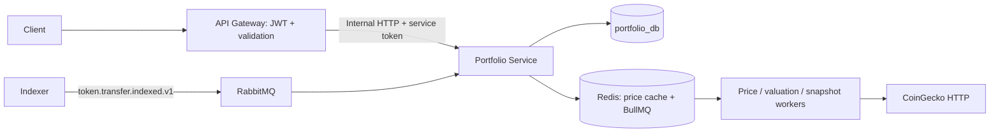

# Phase 8: Portfolio Intelligence

Phase 8 portfolio бағалауын, USD бағаларын, уақыттық snapshots/history, allocation analytics, watchlists және in-app alerts қосты. Phase 7 auth, ownership, Redis/BullMQ, RabbitMQ, transactional outbox және Explorer шекаралары сақталды. Frontend, external email/Telegram notifications және cost-basis есебі бұл фазада қосылмады.

## Архитектура және дерек ағыны



API Gateway тек `identity_db`-ге тікелей кіреді. Portfolio Service `portfolio_db` иесі болып қалады; Indexer `explorer_db` иесі. Public owner ID әрқашан `@CurrentUser().id` арқылы алынады, client body/query ішінде келген `userId` whitelist validation арқылы `400` болады. Gateway request-ке `x-internal-service-token` қосады; internal controllers осы token-ді тексереді. Portfolio, watchlist, item, alert және alert-event read/mutation операциялары SQL-де owner бойынша шектеледі; бөтен немесе archived portfolio үшін `404` беріледі.

`PortfolioHttpClient` timeout, redirects, upstream `400/404/409`, `502/503` және response decoding тәртібін біріктіреді. Public жауапқа raw upstream error, SQL не connection URL шықпайды. Strict TypeScript, NodeNext/ESM және `.js` relative imports сақталды.

## Бағалар, cache және precision

Asset key форматы: ETH үшін `native:eth`, ERC-20 үшін `erc20:0x...` lowercase Ethereum address. CoinGecko native ETH-ті `simple/price`, ERC-20-ті `simple/token_price/ethereum` арқылы алады. Provider response `precision=full`, market cap, 24h change және last-updated timestamp сұрайды. `lossless-json` JSON ішіндегі ақшалай numeric lexeme-ді JS `Number`-ға айналдырмай сақтайды; кейін decimal validation және `decimal.js` қолданылады.

PostgreSQL `prices` — соңғы сақталған баға, `price_snapshots` — price history; Redis — қысқа cache. Бір asset үшін қатар келген refresh сұраулары біріктіріледі. Provider timeout, bounded retries, exponential backoff/jitter, concurrency және rate limit бар; `429` кезіндегі `Retry-After` ортақ client cooldown-ына қолданылады. Provider cooldown-ы configured maximum retry delay-ден ұзақ болса, client ерте retry жасамай error/fallback-қа өтеді. `CoinGeckoHttpError` нақты HTTP status-ты сақтайды; retry log тек status, attempt және cooldown milliseconds көрсетеді, API key/URL жарияламайды. Request лимиті бір provider client/process үшін қолданылады.

Provider unavailable болғанда соңғы сақталған баға болса `stale: true` деп қайтарылады. Ешбір жарамды баға жоқ болса `availability: "unavailable"`, `priceUsd: null`; жалған `0` берілмейді. Белгісіз token symbol public response-та `null`: database compatibility үшін сақталған `UNKNOWN` label public symbol деп берілмейді. Cache немесе provider қатесі API startup-ты қажетсіз тоқтатпайды. Суық cache пен stale баға BullMQ refresh enqueue-ге әкеледі; бір asset үшін қатар келген read request-тері cache TTL бойы scheduler stampede жасамайды. Public read provider-дің ұзақ retry циклін күтпейді.

CoinGecko ERC-20 endpoint-і Ethereum mainnet каталогын қолданады. Sepolia token address-терінің көпшілігі онда жоқ, сондықтан олар үшін `null` баға қалыпты нәтиже. Development Sepolia native ETH бағалауы mainnet ETH reference price-ын қолданады; testnet asset-тің сатылатын нарықтық құнын дәлелдемейді.

`FinanceDecimal` жеке constructor-ы 160 significant digit және half-up rounding қолданады. Balance, price, value, threshold және percentage ақшалай есептері floating-point `Number` арқылы орындалмайды. `Number` тек decimals, pagination, уақыт/interval сияқты бүтін metadata үшін қолданылады. Public ақшалай мәндер exponential notation қолданбайтын normalized decimal string болып беріледі; display USD value әдетте ең көбі 18 fractional digit-ке дөңгелектенеді.

## Valuation және analytics мағынасы

Әр holding үшін:

```text
balance = balanceRaw / 10^decimals
valueUsd = balance × priceUsd
priorPrice = currentPrice / (1 + change24hPercent / 100)
marketChange24hUsd = Σ currentBalance × (currentPrice − priorPrice)
```

`GET /portfolio/:id` жауабы бұрынғы fields/holdings-ті сақтап, `summary` және holding price/value fields қосады. `/valuation` толық `{ portfolio, summary, holdings }` береді.

Нөлден өзгеше holding бағасы жоқ болса, `totalValueUsd: null`, `complete: false`; белгілі активтердің қосындысы `pricedValueUsd` ретінде қалады. Zero-balance asset бағасы белгісіз болғанда оның `priceUsd` мәні `null`, математикалық `valueUsd` мәні `"0"`; unpriced count осы белгісіз бағаны әлі көрсетеді. Ал native balance initial RPC sync арқылы әлі байқалмаса — holding жоқ не `lastUpdatedBlock: null` — бүкіл wallet valuation complete деп көрсетілмейді. Бұл жаңа wallet-ті уақытша жалған zero portfolio деп жариялаудан қорғайды.

`change24hUsd` және `change24hPercent` — қазіргі balance сақталды деген шарттағы 24h **market-price change**. Қажетті price/change жоқ немесе prior-price denominator нөл/теріс болса `marketChangeComplete: false`, өзгеріс `null`. `-100%` change prior price-ты осы формуламен қалпына келтіре алмайды; division жасалмайды. `staleAssetCount` cached stale бағалардың қолданылғанын көрсетеді.

Allocation `pricedValueUsd` subtotal-ына қатысты есептеледі және `allocationBasis: "priced_assets"` деп белгіленеді. Белгісіз активтер allocation-ға енгізілмейді; best/worst asset тек бағасы және жарамды өзгерісі бар nonzero positions арасынан таңдалады. Percentage monetary display rounding-тен бұрын толық decimal precision арқылы есептеледі.

`historicalChange24hUsd/Percent` — қазіргі толық valuation мен шамамен 24h бұрынғы нақты portfolio snapshot айырмасы. Baseline 24h cutoff алдында бір snapshot interval шегінде ғана ізделеді; кез келген ескі snapshot 24h history деп көрсетілмейді. Snapshot baseline жоқ, current total белгісіз немесе denominator zero болса тиісті percentage `null`.

Market change, snapshot change және шынайы сатып алу құнына негізделген P&L үш бөлек ұғым. Deposits/withdrawals snapshot difference-ке әсер етеді. Cost basis деректері жоқ болғандықтан analytics `pnlAvailable: false`, `pnlReason: "cost_basis_unavailable"` береді; fabricated profit/loss есептелмейді.

## Snapshots және history

Snapshot worker active portfolio-ларды бағалайды. Unsynced native balance, nonzero unpriced holding, stale price немесе existing numeric storage-ке сыймайтын value болса snapshot жазылмайды және себебі log-қа түседі. Cached stale price public valuation-да көрсетілуі мүмкін, бірақ metadata жоқ history row-да fresh observation деп жазылмайды. Нақты RPC-observed native zero balance бар және барлық holding raw balance-тері zero portfolio `"0"` snapshot жаза алады.

Existing `portfolio_snapshots.total_value_usd` — `numeric(38,2)`, сондықтан history USD values cents-ке дөңгелектенеді; `total_value_eth` — nullable `numeric(38,18)`. ETH conversion fresh positive ETH price қолданады; price zero/unavailable/stale болса nonzero holdings бар portfolio-ның ETH value-і `null`, USD value zero болғанның өзінде `0/0` есептелмейді. Барлық нақты raw balances zero болса ETH value `"0"` бола алады. Осы column-дардан асып кететін өте үлкен valuation snapshot-тары skip етіледі; API valuation precision сақтайды. Raw SQL history timestamps runtime decoder арқылы Date-ке айналады, money columns string ретінде сақталады.

`PORTFOLIO_SNAPSHOT_INTERVAL_MS` уақытты тұрақты bucket-терге бөледі. Transaction advisory lock, active portfolio row lock және bucket ішіндегі existing-row check бірнеше worker/retry кезінде duplicate snapshot-ты болдырмайды. `recordedAt` нақты бақылау уақыты болып қалады; bucket start жалған бақылау timestamp-ы ретінде жазылмайды. Snapshot dedup үшін жаңа schema migration қажет болмады.

History `range=24h|7d|30d|90d`, `limit=2..1000` қабылдайды, default `7d`/`100`. SQL бүкіл requested range-ді rank buckets арқылы іріктейді: бірінші және соңғы point сақталады, response limit-тен аспайды, timestamps oldest-to-newest ретімен келеді. Бұл тек соңғы N snapshot-ты алып, chart-тың ертеректегі бөлігін жоғалтудан сақтайды.

Existing `portfolio-jobs` queue жаңа typed job-тарды қабылдайды:

- `refresh-asset-price` — бір asset бағасын жаңарту; asset hash + time-bucket job ID duplicate fetch enqueue-ді шектейді.
- `refresh-active-prices` — active holdings/alert asset бағалары үшін scheduled refresh.
- `snapshot-portfolio` — бір active portfolio snapshot-ы; interval job ID және DB transaction dedup қатар қолданылады.
- `refresh-portfolio-valuations` — active portfolio valuations және periodic snapshots.
- `evaluate-transfer-alerts` — immutable transfer event-ті retry арқылы бағалау; source-event job ID және DB event-key dedup қолданылады.

Бұрынғы `sync-portfolio`, `sync-token-holding`, `rebuild-portfolio` jobs сақталды. Initial/token/reorg sync-тен кейін snapshot әрекеті latest observed holdings-ке сүйенеді. BullMQ retry/backoff және graceful shutdown сақталған. Scheduler `PRICE_REFRESH_INTERVAL_MS` және `PORTFOLIO_SNAPSHOT_INTERVAL_MS` қолданады. `PRICE_SCHEDULER_ENABLED=false` тек configured queue ішіндегі осы service-ке тиесілі екі reserved scheduler ID-ді (`refresh-active-prices`, `refresh-portfolio-valuations`) алып тастайды; queue drain/flush жасалмайды. Verification scripts жеке queue namespace қолданғандықтан normal service schedulers-іне әсер етпейді.

## Watchlists және alerts

Watchlist name trim жасалады, ұзындығы 1–100. Item type — `address` немесе `token`; address Ethereum форматында тексеріліп, lowercase сақталады. Label optional, берілсе 1–100 таңба; `null` және бос label public validation-нан өтпейді. Item ownership parent watchlist арқылы тексеріледі; бірдей watchlist/type/address duplicate `409` болады.

Alert түрлері:

| Type | Config және іске қосылуы |
| --- | --- |
| `wallet_activity` | `walletAddress` міндетті; token optional filter; threshold қабылдамайды. Indexed ERC-20 transfer wallet-тің from/to жағына сәйкес келсе event жасалады. |
| `whale` | Positive USD threshold; берілмесе `WHALE_DEFAULT_THRESHOLD_USD`. Wallet/token optional filters. Transfer amount decimals-пен форматталып, fresh current price арқылы USD reference value есептеледі. |
| `price_above` | Positive decimal-string `thresholdUsd`; token жоқ болса native ETH. Wallet filter қабылдамайды. |
| `price_below` | `price_above` тәртібімен төменгі threshold-ты бақылайды. |

`enabled: false` evaluation-нан шығарады. Бос alert PATCH `400`; decimal threshold numeric JSON/float, exponential string, zero немесе negative мән қабылдамайды. Update қолданыстағы config-пен transaction ішіндегі merge/revalidation арқылы тексеріледі.

Price rule-дың бірінші fresh observation-ы **baseline** орнатады, бірден event жасамайды. Кейінгі observed condition `false → true` ауысқанда event жасалады; condition true болып қала берсе repeated price refresh жаңа event бермейді. Rule өзгерсе baseline reset болады. Stale/unavailable price crossing evaluation-да қолданылмайды; бұрынғы valid baseline сақталады. Fetched timestamp ескі не қайталанған болса қайта evaluation жасалмайды.

Transfer rule event key: chain + transaction hash + log index; event unique index-і rule + event key бойынша duplicate-ты тоқтатады. Бұл Rabbit redelivery, BullMQ retry және process restart кезінде қолданылады. Wallet-activity event fresh USD бағасына тәуелді емес. Whale alert үшін metadata/баға жетіспесе event fabricated USD-мен жасалмайды: evaluation retry болады; wallet-activity effect idempotent сақталады. Whale USD — transfer block кезіндегі тарихи price емес, fresh current price reference; payload осы basis/fetched timestamp-ты көрсетеді.

Whale evaluation қазір indexed **ERC-20 Transfer** оқиғаларын ғана қолданады; native ETH transaction whale detection бұл фазада іске асырылған жоқ. `token.transfer.indexed.v1` version/routing key сақталды; `tokenDecimals` және `tokenSymbol` optional metadata ретінде қосылды. Ескі v1 producer metadata бермесе decimals existing ERC-20 RPC client арқылы алынады. Metadata guards malformed values-ті reject етеді, source event immutable күйінде alert retry job-қа беріледі.

Бұл фазада тек database-те сақталатын in-app notification бар: title, message, payload, triggeredAt, readAt. Email/push/Telegram кейін notification delivery layer арқылы қосылады.

## Public endpoints

| Method | Endpoint | Access |
| --- | --- | --- |
| GET | `/prices/eth` | Public |
| GET | `/prices/token/:address` | Public; Ethereum address validation |
| GET | `/portfolio/:id` және `/holdings` | JWT; additive valuation fields |
| GET | `/portfolio/:id/valuation` | JWT |
| GET | `/portfolio/:id/history?range=7d&limit=100` | JWT |
| GET | `/portfolio/:id/analytics` | JWT |
| POST, GET | `/watchlists` | JWT; create/list |
| GET, PATCH, DELETE | `/watchlists/:id` | JWT; detail/rename/delete |
| POST | `/watchlists/:id/items` | JWT |
| DELETE | `/watchlists/:id/items/:itemId` | JWT |
| POST, GET | `/alerts` | JWT; create/list |
| GET, PATCH, DELETE | `/alerts/:id` | JWT |
| GET | `/alerts/events` | JWT; pagination |
| PATCH | `/alerts/events/:id/read` | JWT; repeated mark-read idempotent |

Watchlist/alert list және alert-event list `{ items, page, limit, total, totalPages }` береді, default `page=1`, `limit=20`, max `limit=100`. UUID route params тексеріледі. Internal counterparts `/internal/prices`, `/internal/portfolios/:id/{valuation,history,analytics}`, `/internal/watchlists`, `/internal/alerts` prefix-терін және service-token authentication қолданады. List/read/mutation query-лерінде trusted `userId` бар; internal create body-де Gateway орнатқан `userId` бар.

## Environment және dependencies

Нақты secrets тек ignored `.env` ішінде сақталады. Existing JWT, database, Redis, RabbitMQ, RPC, `INTERNAL_SERVICE_TOKEN` және `PORTFOLIO_INTERNAL_URL` конфигурациясы қайта қолданылады.

| Variable | Default / қызметі |
| --- | --- |
| `COINGECKO_BASE_URL` | Demo: `https://api.coingecko.com/api/v3`; pro key type үшін pro API URL |
| `COINGECKO_API_KEY` | Optional; hardcode жасалмайды |
| `COINGECKO_API_KEY_TYPE` | `demo` немесе `pro`, default `demo` |
| `COINGECKO_TIMEOUT_MS` | `10000` |
| `COINGECKO_MAX_RETRIES` | `4`, max `6` |
| `COINGECKO_RETRY_BASE_DELAY_MS` | `500` |
| `COINGECKO_MAX_RETRY_DELAY_MS` | `60000` |
| `COINGECKO_MAX_CONCURRENT_REQUESTS` | `2` |
| `COINGECKO_REQUESTS_PER_SECOND` | `0.3`, per client/process |
| `PRICE_CACHE_TTL_SECONDS` | `30` |
| `PRICE_UNAVAILABLE_CACHE_TTL_SECONDS` | `30` |
| `PRICE_STALE_AFTER_SECONDS` | `300` |
| `PRICE_CACHE_TIMEOUT_MS` | `750` |
| `PRICE_REFRESH_INTERVAL_MS` | `60000`; active prices recurring refresh |
| `PORTFOLIO_SNAPSHOT_INTERVAL_MS` | `300000`, valid `60000..86400000` |
| `PRICE_SCHEDULER_ENABLED` | `true`; recurring price/valuation scheduling |
| `WHALE_DEFAULT_THRESHOLD_USD` | `100000`, positive decimal string |
| `PORTFOLIO_EVENTS_QUEUE` | `portfolio.events`; isolated integration үшін бөлек namespace қолдануға болады |

`.env.example` осы settings-ті көрсетеді. Local ignored `.env` жаңа config values-пен толықтырылды; existing credentials сақталды, secret values құжатқа немесе Git diff-ке енгізілмейді. Phase 7 regression-да price scheduler жеке verification queue ішінде ғана өшіріледі.

Portfolio Service direct dependencies: `decimal.js` **10.6.0**, `lossless-json` **4.3.1**. Бастапқы `^10.6.0` / `^4.3.0` specifiers lockfile-де осы versions-қа resolved. Existing Drizzle, class-validator/transformer, Redis, RabbitMQ, BullMQ **5.81.5** және workspace contracts қайта қолданылады; Prisma/ethers/viem қосылған жоқ.

## Migration

`apps/portfolio-service/src/database/migrations/0002_lucky_rocket_racer.sql` жасалды:

- `alerts.threshold_usd` scale `numeric(78,18)` болды: жоғары precision thresholds cents-ке жоғалмайды.
- `alert_events.event_key` және `(alert_id,event_key)` unique index қосылды: retry/replay event dedup.
- `alerts.last_condition_met`, `last_evaluated_at` қосылды: price crossing baseline transaction ішінде тұрақты сақталады.

Drizzle schema, generated snapshot және `_journal.json` бірге жаңартылды. Generated `0002` SQL inspected және `pnpm --dir apps/portfolio-service db:migrate` арқылы сәтті қолданылды. Алдыңғы migration history жойылмайды; isolated verification temporary databases-ке migrations-ты қайта қолданады.

```powershell
pnpm --dir apps/portfolio-service db:migrate
```

## Build, tests және іске қосу

```powershell
pnpm install
pnpm build:packages
pnpm --dir apps/api-gateway build
pnpm --dir apps/indexer-service build
pnpm --dir apps/portfolio-service build

pnpm --dir apps/api-gateway test
pnpm --dir apps/portfolio-service test
pnpm --dir apps/indexer-service test

pnpm infra:up
```

Расталған толық unit suites: API Gateway **48**, Indexer **5**, Portfolio Service **106** — барлығы **159 tests passed**. Оның **100** тесті Phase 8-де қосылды, **59** бұрынғы Phase 7 regressions сақталды. Analytics **22** және Gateway intelligence **8** тесті осы толық suite құрамына кіреді. Precision, unknown/native readiness, raw SQL timestamp decoding, stale/zero-price snapshot semantics, history bounds, ownership, DTO validation, scheduler dedup, retry/rate-limit, crossing baseline, alert replay және backward-compatible v1 metadata тексерілді.

Расталған integration нәтижелері:

- Үш service health e2e — **3/3 passed**: API database/Redis, Portfolio database/BullMQ/RabbitMQ, Indexer database readiness.
- `pnpm verify:phase7` — **11 checks passed**: isolated databases/cache/queue/broker ішіндегі нақты services және өзгертілмеген configured Ethereum RPC native balance салыстыруы. Own processes graceful shutdown жасап, барлық temporary resources тазаланды.
- `pnpm verify:phase8` — **24 checks passed**: нақты PostgreSQL/Redis/RabbitMQ және built services, deterministic CoinGecko/Ethereum RPC fixtures; ownership, CRUD, decimal precision, snapshots, crossing, transfer retry/replay және cleanup.
- `pnpm verify:phase8 -- --real-coingecko` — **25 checks passed**, cleanup өтті. Қосымша нақты official CoinGecko ETH public endpoint keyless request-пен тексерілді; бұл нәтиже fixture provider тестінен бөлек нақты network check.

Міндетті финалдық pipeline сәтті аяқталды: `pnpm install`, `pnpm build:packages`, API Gateway, Indexer және Portfolio Service build командаларының бәрі **exit 0**, **0 TypeScript errors**. Соңғы CoinGecko HTTP error/retry logging түзетуінен кейін client-тің сегіз тесті де қайта өтті. Қалған build/test/integration blocker жоқ.

`scripts/verify-phase-7.mjs` auth/native RPC regression үшін де үш temporary database және жеке cache/queue/broker namespace қолданады; нақты configured Ethereum RPC fixture-мен ауыстырылмайды.

`scripts/verify-phase-8.mjs` үш built service-ті 3400/3401/3402 порттарында, temporary databases және invocation-ға ғана тиесілі Redis/BullMQ/Rabbit namespaces ішінде іске қосады. PostgreSQL, Redis, RabbitMQ және services нақты; CoinGecko мен Ethereum RPC жауабы deterministic local fixture арқылы басқарылады. Ownership, precision, price fallback, snapshots, watchlist/alert CRUD, crossing және transfer replay тексеріліп, тек өз namespace/databases/process-тері тазаланады. Optional live-provider check isolated fixture flow-дан бөлек хабарланады.

Manual flow: register/login → create portfolio → initial native sync күту → price/read/valuation → history/analytics → watchlist/item CRUD → alert create/list/update → indexed wallet transfer/price crossing → alert events → mark-read. Екінші user арқылы барлық private resource detail/update/delete/event access `404`, JWT жоқ болса `401`, malformed UUID/input `400`, duplicate item `409` екенін тексеріңіз.

## Жаңа файлдар

Төмендегі prefix әр қатардағы барлық filename-ге қатысты. Тізім Phase 8 working tree `git status` және `rg --files` негізінде берілген: **56 жаңа файл**, build-generated үш `tsconfig.build.tsbuildinfo` есепке алынбай **29 tracked файл өзгерді**. Ignored `.env` config update Git inventory-ге кірмейді.

| Prefix | Жаңа файлдар |
| --- | --- |
| `packages/contracts/src/` | `http/intelligence.contracts.ts`, `utils/asset-key.ts` |
| `apps/indexer-service/src/modules/messaging/` | `indexer-event.factory.spec.ts` — optional v1 metadata үшін бес regression test |
| `apps/portfolio-service/src/common/utils/` | `decimal-math.ts` |
| `apps/portfolio-service/src/modules/prices/` | `prices.module.ts`, `prices.controller.ts`, `prices.service.ts`, `prices.repository.ts`, `prices.cache.ts`, `prices.config.ts`, `coingecko.client.ts`, `price-request-limiter.ts`, `price-decimal.ts`, `prices.service.spec.ts`, `prices.cache.spec.ts`, `coingecko.client.spec.ts`, `price-request-limiter.spec.ts` |
| `apps/portfolio-service/src/modules/analytics/` | `analytics.module.ts`, `analytics.controller.ts`, `analytics.service.ts`, `analytics.repository.ts`, `valuation.math.ts`, `dto/analytics-query.dto.ts`, `analytics.fixtures.ts`, `analytics.service.spec.ts`, `analytics.repository.spec.ts`, `valuation.math.spec.ts` |
| `apps/portfolio-service/src/modules/watchlists/` | `watchlists.module.ts`, `watchlists.controller.ts`, `watchlists.service.ts`, `watchlists.repository.ts`, `dto/watchlist.dto.ts`, `watchlists.spec.ts` |
| `apps/portfolio-service/src/modules/alerts/` | `alerts.module.ts`, `alerts.controller.ts`, `alerts.service.ts`, `alerts.repository.ts`, `alert-evaluation.ts`, `dto/alert.dto.ts`, `alerts.service.spec.ts`, `alerts.repository.spec.ts`, `alert-evaluation.spec.ts` |
| `apps/api-gateway/src/common/http/` | `portfolio-http.client.ts`, `response-fields.ts`, `intelligence-response.decoder.ts` |
| `apps/api-gateway/src/modules/intelligence/` | `intelligence.module.ts`, `intelligence.client.ts`, `prices.controller.ts`, `watchlists.controller.ts`, `alerts.controller.ts`, `dto/intelligence.dto.ts`, `intelligence.client.spec.ts` |
| `apps/portfolio-service/src/database/migrations/` | `0002_lucky_rocket_racer.sql`, `meta/0002_snapshot.json` |
| `docs/` | `phase-8-portfolio-intelligence.md` |
| `scripts/` | `verify-phase-8.mjs` |

## Өзгерген файлдар

| Файлдар | Өзгеріс |
| --- | --- |
| `packages/contracts/src/index.ts`, `http/portfolio.contracts.ts` | Intelligence exports; detail summary/holding price fields additive contract |
| `packages/contracts/src/events/blockchain.events.ts`, `blockchain-event.guards.ts` | Optional transfer token metadata және runtime validation |
| `apps/indexer-service/src/modules/chain-sync/block-processor.service.ts`, `modules/messaging/indexer-event.factory.ts` | ERC-20 decimals/symbol metadata-ны existing transfer event-ке қосу |
| `apps/portfolio-service/package.json`, `pnpm-lock.yaml` | Direct decimal/lossless dependencies және resolution |
| `.env.example`, `package.json` | CoinGecko/cache/scheduler/whale settings және verification script entry |
| `apps/portfolio-service/src/app.module.ts` | Prices, analytics, watchlist, alert modules integration |
| `apps/portfolio-service/src/database/schema/alerts.schema.ts`, `database/migrations/meta/_journal.json` | Threshold precision, event dedup және crossing baseline schema |
| `apps/portfolio-service/src/modules/jobs/jobs.module.ts` | Pricing/analytics/alerts providers worker үшін қолжетімді |
| `apps/portfolio-service/src/modules/jobs/portfolio-job.types.ts`, `portfolio-jobs.service.ts`, `apps/portfolio-service/src/workers/portfolio-jobs.worker.ts` | Typed refresh/snapshot/alert jobs, recurring schedulers және sync-тен кейінгі snapshots |
| `apps/portfolio-service/src/modules/messaging/portfolio-events.consumer.ts` | Durable transfer alert enqueue және configurable consumer queue |
| `apps/portfolio-service/src/modules/portfolios/portfolios.module.ts`, `portfolios.service.ts` | Detail/holdings-ке additive valuation integration |
| `apps/api-gateway/src/app.module.ts`, `modules/portfolio/portfolio.module.ts`, `portfolio.controller.ts` | Intelligence BFF және JWT history/analytics/valuation routes |
| `apps/api-gateway/src/modules/portfolio/portfolio.client.ts`, `portfolio-response.decoder.ts` | Shared HTTP transport reuse және additive response fields runtime validation |
| `apps/api-gateway/test/app.e2e-spec.ts`, `apps/portfolio-service/test/app.e2e-spec.ts` | Existing health assertions және scheduler toggle |
| `scripts/verify-phase-7.mjs`, `docs/phase-7-auth-portfolio.md` | Phase 7 regression үшін full database/cache/queue/broker isolation және resource documentation |

Build-generated `tsconfig.build.tsbuildinfo` үш файлы business changes ретінде есептелмейді және source diff-ке енгізілмейді.

## Phase 9 foundation

Frontend dashboard үшін typed valuation/history/analytics endpoints дайын. Notification UI watchlist және alert-event CRUD/mark-read пайдалана алады. Price providers бір client/service boundary-мен ауыстырылады; scheduler/worker hooks provider fetch, valuation және snapshot міндеттерін бөледі. Alert delivery, cost-basis trades/lots, flow-adjusted performance, multi-chain provider mapping және толық token discovery осы contracts/ownership/idempotency үстіне қосылады.
